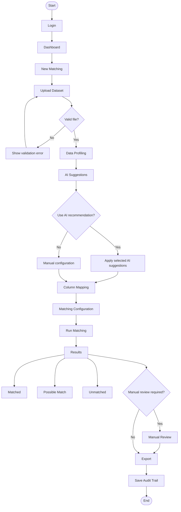

# PRD: BatchMatch - Website Matching Data

## 0. Identitas Produk dan Versi

Nama produk: `BatchMatch`.

Versi dokumen:

- `BatchMatch v0.1.0 MVP`: versi awal untuk upload file, konfigurasi kolom, exact/fuzzy/composite matching, review manual, dan export hasil.
- `BatchMatch v0.2.0`: versi lanjutan untuk template konfigurasi, deduplication dalam satu file, dan peningkatan evaluasi kualitas match.
- `BatchMatch v0.3.0`: versi lanjutan untuk probabilistic matching, active learning dari keputusan reviewer, dan koneksi database.
- `BatchMatch v1.0.0`: versi production-ready dengan role/permission, audit trail penuh, job queue, API, dan deployment enterprise.

Nama modul utama:

- `BatchMatch Ingest`: upload dan parsing file.
- `BatchMatch Profiler`: profiling kualitas data.
- `BatchMatch Mapper`: mapping kolom dan konfigurasi field.
- `BatchMatch Match Engine`: exact, fuzzy, composite, rule-based, dan probabilistic matching.
- `BatchMatch Review`: review manual dan validasi hasil.
- `BatchMatch Export`: export hasil, mapping key, audit trail, dan konfigurasi.

## 1. Ringkasan Produk

BatchMatch adalah aplikasi web untuk mencocokkan data dari satu atau lebih file input terhadap file rujukan. Pengguna dapat mengunggah file rujukan dan file yang akan dicocokkan, memilih kolom pembanding, menentukan metode matching, melihat hasil similarity, lalu mengekspor hasil dalam beberapa opsi output.

Produk ini ditujukan untuk pekerjaan rekonsiliasi data, validasi master data, integrasi data antar sistem, pembersihan data, dan pembuatan relasi antar dataset.

## 2. Tujuan MVP

MVP berfokus pada kemampuan inti berikut:

1. Mengunggah file rujukan dan file yang akan dicocokkan.
2. Membaca beberapa format file umum.
3. Memilih kolom yang digunakan untuk matching dari masing-masing file.
4. Menjalankan exact match dan fuzzy/similarity match.
5. Menampilkan hasil matching beserta skor similarity.
6. Memberikan opsi hasil: update file rujukan, membuat file hasil baru, atau membuat unique key/foreign key.
7. Mengekspor hasil ke format file yang mudah digunakan kembali.

## 3. Masalah yang Diselesaikan

Banyak proses bisnis membutuhkan pencocokan data dari sumber berbeda, misalnya:

- Mencocokkan daftar pegawai dari sistem A dengan sistem B.
- Mencocokkan nama perusahaan dari file Excel terhadap database rujukan.
- Mencocokkan alamat, NIK, NPWP, kode barang, rekening, atau nama entitas yang memiliki variasi penulisan.
- Membuat relasi antara data transaksi dan data master.
- Menemukan data yang belum ada di file rujukan.

Tanpa alat khusus, proses ini sering dilakukan manual di Excel, rentan salah, sulit dilacak, dan tidak konsisten.

## 4. Target Pengguna

1. Admin data atau data steward.
2. Analis bisnis.
3. Tim operasional yang sering mengelola file spreadsheet, tabel, database export, dan file data lainnya.
4. Tim IT atau data engineering yang membutuhkan validasi awal sebelum integrasi.
5. Auditor atau pemeriksa data.

## 5. Scope MVP

### 5.1 In Scope

- Upload file rujukan.
- Upload file data yang akan dicocokkan.
- Dukungan input berbasis kategori file data, bukan ekstensi tertutup:
  - Spreadsheet: `.xlsx`, `.xls`, `.xlsm`, `.ods`, dan format spreadsheet lain.
  - Delimited text: `.csv`, `.tsv`, `.txt`, `.psv`, fixed-width text, dan varian delimiter lain.
  - Structured/semi-structured data: `.json`, `.jsonl`, `.xml`, `.yaml`, `.yml`, `.parquet`, `.avro`, `.orc`.
  - Database/export legacy: `.dbf`, `.sqlite`, `.sqlite3`, `.mdb`, `.accdb`, `.sql`, dump table, dan database export lain.
  - Statistical/data science files: `.sav`, `.dta`, `.sas7bdat`, `.feather`, `.arrow`, `.rds` jika parser tersedia.
  - Compressed data package: `.zip`, `.gz`, `.bz2`, `.7z` jika berisi file data yang dapat diparse.
  - Format lain yang memiliki struktur tabular atau dapat dinormalisasi menjadi tabel.
- Preview isi file.
- Deteksi header kolom.
- Mapping kolom antara file rujukan dan file input.
- Pemilihan satu kolom, beberapa kolom, atau seluruh kolom sebagai basis matching.
- Exact match.
- Fuzzy match berbasis similarity score.
- Pengaturan threshold similarity.
- Hasil berupa matched, possible match, dan unmatched.
- Export hasil minimal ke `.xlsx` dan `.csv`, dengan desain terbuka untuk format export lain seperti `.json`, `.jsonl`, `.parquet`, `.sqlite`, dan database table.
- Log sederhana proses matching.

### 5.2 Out of Scope untuk MVP

- Matching real-time ke database produksi.
- Integrasi API eksternal.
- Multi-user approval workflow.
- Machine learning training khusus per organisasi.
- Data lineage tingkat enterprise.
- Role-based access control kompleks.
- Penjadwalan matching otomatis.
- Deduplication lintas banyak file secara paralel.

Fitur di atas dapat masuk roadmap setelah MVP stabil.

## 6. User Journey MVP

1. Pengguna membuka halaman utama aplikasi.
2. Pengguna mengunggah file rujukan.
3. Pengguna mengunggah file yang ingin dicocokkan.
4. Sistem membaca file dan menampilkan preview data.
5. Pengguna memilih sheet/table jika file memiliki lebih dari satu sheet/table.
6. Pengguna menentukan header dan tipe data kolom bila diperlukan.
7. Pengguna memilih kolom dari file rujukan.
8. Pengguna memilih kolom dari file input.
9. Pengguna memilih metode matching.
10. Pengguna mengatur threshold similarity.
11. Pengguna memilih output hasil matching.
12. Sistem menjalankan proses matching.
13. Pengguna melihat ringkasan hasil dan tabel detail.
14. Pengguna melakukan review manual untuk possible match.
15. Pengguna mengekspor hasil.

## 7. Fitur Utama

### 7.1 Upload File

Pengguna dapat mengunggah dua jenis file:

- File rujukan: dataset master atau referensi.
- File input: dataset yang akan dicocokkan terhadap file rujukan.

Ketentuan MVP:

- Ukuran file maksimal dapat dikonfigurasi, default 50 MB.
- Sistem memvalidasi format file berdasarkan ekstensi, MIME type, signature/header file, dan kemampuan parser.
- Sistem memberi pesan error jika file tidak dapat dibaca.
- Untuk spreadsheet, pengguna dapat memilih sheet, named range, atau table jika tersedia.
- Untuk delimited text, pengguna dapat memilih delimiter, encoding, quote character, escape character, dan header row jika auto-detect gagal.
- Untuk fixed-width text, pengguna dapat menentukan posisi kolom atau menggunakan deteksi otomatis.
- Untuk structured/semi-structured data seperti JSON, JSONL, XML, atau YAML, sistem melakukan flattening menjadi struktur tabel.
- Untuk columnar/big data format seperti Parquet, Avro, ORC, Arrow, atau Feather, sistem membaca schema dan mengubahnya menjadi tabel preview.
- Untuk database/export legacy seperti DBF, SQLite, MDB/ACCDB, atau SQL dump, sistem membaca table/field sebagai kolom jika connector tersedia.
- Untuk archive/compressed file, sistem menampilkan daftar file di dalam archive dan meminta pengguna memilih file data yang akan diproses.
- Untuk format yang belum didukung, sistem harus memberi pesan bahwa parser belum tersedia dan menyarankan konversi ke format terbuka seperti `.csv`, `.xlsx`, `.jsonl`, atau `.parquet`.

### 7.1.1 Strategi Dukungan Format Data

BatchMatch tidak boleh didesain sebagai aplikasi yang hanya menerima beberapa ekstensi tertentu. Semua format input diperlakukan sebagai sumber data yang harus dinormalisasi menjadi struktur tabel sebelum masuk ke proses profiling, mapping, dan matching.

Prioritas dukungan format:

1. Tier 1 - Wajib MVP
   - Spreadsheet dan delimited text karena paling umum dipakai pengguna bisnis.
   - Structured data sederhana seperti JSON/JSONL/XML jika dapat diflatten menjadi tabel.
   - DBF karena masih sering muncul pada data legacy.

2. Tier 2 - Setelah MVP
   - Parquet, Avro, ORC, Feather, Arrow.
   - SQLite, SQL dump, Access database, dan database export lain.
   - Fixed-width text dan file arsip berisi banyak dataset.

3. Tier 3 - Parser berbasis kebutuhan
   - Statistical files seperti SPSS, Stata, SAS, RDS.
   - Domain-specific files seperti geospatial attribute table, log export, ERP export, CRM export, core banking export, atau format pemerintah/instansi tertentu.

Prinsip parser:

- Parser harus modular dan dapat ditambah tanpa mengubah algoritma matching.
- Setiap parser menghasilkan output standar berupa table schema, rows, column metadata, dan parse warnings.
- Jika satu file berisi banyak table/sheet/dataset, pengguna harus dapat memilih bagian yang akan dijadikan file rujukan atau file input.
- Jika struktur file nested, sistem harus menyediakan opsi flattening, explode array, dan pemilihan path data.
- Semua keputusan parsing harus disimpan di sheet/config hasil export agar proses dapat direproduksi.

### 7.2 Preview dan Profiling Data

Sistem menampilkan preview data sebelum matching:

- Nama kolom.
- Contoh 20-100 baris pertama.
- Jumlah baris.
- Jumlah kolom.
- Persentase nilai kosong per kolom.
- Tipe data hasil deteksi: text, number, date, boolean.
- Jumlah nilai unik per kolom.
- Persentase duplikasi per kolom.
- Nilai paling sering muncul.
- Deteksi outlier sederhana untuk angka dan tanggal.
- Deteksi pola umum, misalnya email, nomor telepon, NIK, NPWP, kode pos, atau kode barang.

Tujuan fitur ini adalah membantu pengguna memilih kolom matching secara tepat.

Output profiling harus memberi rekomendasi awal:

- Kolom yang berpotensi menjadi primary key atau unique identifier.
- Kolom yang terlalu kosong sehingga sebaiknya tidak diberi bobot tinggi.
- Kolom yang terlalu umum sehingga hanya cocok sebagai konteks pendukung.
- Kolom yang perlu dibersihkan sebelum matching, misalnya banyak spasi, tanda baca, format tanggal campur, atau variasi singkatan.

### 7.3 Pemilihan Kolom Matching

Pengguna dapat memilih strategi kolom:

1. Satu kolom saja.
   - Contoh: `NIK` dibandingkan dengan `Nomor Induk`.

2. Beberapa kolom digabung.
   - Contoh: `Nama + Tanggal Lahir + Kota`.

3. Beberapa kolom dengan bobot.
   - Contoh:
     - `Nama`: 60%
     - `Tanggal Lahir`: 25%
     - `Kota`: 15%

4. Seluruh kolom.
   - Sistem menggunakan semua kolom yang dipilih otomatis atau seluruh kolom tabel untuk menilai similarity.

5. Kolom berbeda nama tetapi makna sama.
   - Contoh kolom `Company Name` pada file input dimapping ke `Nama Perusahaan` pada file rujukan.

6. Kolom dengan aturan wajib.
   - Contoh: `Tanggal Lahir` harus sama persis, sementara `Nama` boleh fuzzy.
   - Contoh: `Negara` harus sama sebelum sistem membandingkan nama perusahaan.

7. Kolom dengan algoritma berbeda.
   - Contoh: `Nama` menggunakan Jaro-Winkler atau token ratio.
   - Contoh: `Alamat` menggunakan token-based similarity.
   - Contoh: `Tanggal` menggunakan date tolerance.

Aturan MVP:

- Pengguna harus memilih minimal satu kolom dari file rujukan dan satu kolom dari file input.
- Jika beberapa kolom dipilih, sistem membuat composite matching key sementara.
- Pengguna dapat memilih apakah urutan kolom berpengaruh atau tidak.
- Jika bobot digunakan, total bobot seluruh kolom harus 100%.
- Sistem memberi peringatan jika pengguna memberi bobot tinggi pada kolom yang banyak kosong, terlalu umum, atau banyak duplikasi.

### 7.4 Normalisasi Data

Sebelum matching, sistem menyediakan opsi normalisasi:

- Ubah semua huruf menjadi lowercase.
- Trim spasi di awal dan akhir.
- Hapus spasi ganda.
- Hapus tanda baca.
- Abaikan perbedaan kapitalisasi.
- Abaikan karakter khusus.
- Standarisasi tanggal.
- Standarisasi angka.
- Hapus prefix/suffix umum.
- Abaikan kata umum tertentu, misalnya `PT`, `CV`, `Tbk`, `Ltd`, `Inc`.
- Hapus karakter non-printable.
- Hapus atau normalisasi accent/diacritic, misalnya `é` menjadi `e`.
- Standarisasi singkatan umum, misalnya `Jl.` menjadi `Jalan`, `St.` menjadi `Street`, `Co.` menjadi `Company`.
- Standarisasi nomor telepon, kode pos, NIK, NPWP, dan kode referensi.
- Pecah field gabungan jika memungkinkan, misalnya alamat yang mengandung kota atau kode pos.
- Perlakukan nilai kosong secara eksplisit agar tidak dianggap sama hanya karena sama-sama kosong.

Normalisasi dapat diaktifkan/nonaktifkan per proses matching.

Untuk MVP, sistem menyediakan preset normalisasi:

1. Basic
   - Lowercase, trim, hapus spasi ganda, dan abaikan kapitalisasi.

2. Text Standardization
   - Basic ditambah hapus tanda baca, normalisasi singkatan, dan hapus karakter khusus.

3. Entity Name
   - Text Standardization ditambah opsi abaikan kata legal entity seperti `PT`, `CV`, `Tbk`, `Ltd`, `Inc`, `LLC`.

4. Address
   - Text Standardization ditambah normalisasi singkatan jalan, nomor, kode pos, kota, dan token alamat.

5. Identifier Strict
   - Hanya trim, hapus spasi tidak perlu, dan standarisasi format. Tidak melakukan fuzzy cleanup berlebihan agar ID tidak salah match.

### 7.5 Metode Matching

MVP menyediakan beberapa metode:

1. Exact Match
   - Data dianggap match jika nilai sama persis setelah normalisasi.

2. Contains Match
   - Data dianggap match jika satu nilai mengandung nilai lainnya.

3. Fuzzy Text Match
   - Menggunakan skor similarity untuk teks.
   - Cocok untuk nama, alamat, nama perusahaan, atau deskripsi barang.

4. Token-Based Match
   - Membandingkan kata/token tanpa terlalu bergantung pada urutan kata.
   - Cocok untuk variasi seperti `PT ABC Indonesia` vs `ABC Indonesia PT`.

5. Numeric Match
   - Cocok untuk angka dengan toleransi tertentu.
   - Contoh toleransi: selisih maksimal 1, 10, 100, atau 0.5%.

6. Date Match
   - Cocok untuk tanggal dengan format berbeda.
   - Opsi toleransi: sama persis, selisih 1 hari, 7 hari, atau custom.

7. Composite Match
   - Menggabungkan beberapa kolom dengan bobot tertentu.
   - Skor akhir dihitung dari rata-rata berbobot.

8. Character-Based Match
   - Mengukur kedekatan karakter.
   - Cocok untuk typo kecil, transposisi huruf, nama pendek, kode pendek, dan identifier yang kadang salah ketik.
   - Contoh algoritma: Levenshtein distance dan Jaro-Winkler.

9. Phonetic Match
   - Membandingkan kemiripan bunyi.
   - Cocok untuk nama orang yang bisa memiliki variasi ejaan.
   - Contoh algoritma: Soundex, Metaphone, atau Double Metaphone.
   - Untuk MVP, phonetic match dijadikan opsi lanjutan karena kualitasnya sangat bergantung pada bahasa dan domain data.

10. TF-IDF/Cosine Match
   - Mengubah teks menjadi vektor berbasis token, lalu menghitung kedekatan antar vektor.
   - Cocok untuk alamat panjang, deskripsi barang, nama produk, atau teks yang lebih panjang.

11. Rule-Based Match
   - Menggabungkan rule bisnis dengan skor similarity.
   - Contoh: auto-match jika email sama persis; review jika nama > 85 dan alamat > 75; reject jika negara berbeda.

12. Hybrid Match
   - Menggabungkan exact, fuzzy, token, numeric/date tolerance, dan rule bisnis.
   - Cocok sebagai mode default untuk dataset bisnis yang kolomnya campuran.

### 7.5.1 Rekomendasi Algoritma per Tipe Kolom

| Tipe kolom | Algoritma default | Catatan |
| --- | --- | --- |
| Email | Exact atau normalized exact | Bobot tinggi, cocok sebagai rule auto-match jika kualitas data baik |
| Nomor telepon | Normalized exact | Hapus spasi, tanda plus, dash, dan kode negara jika perlu |
| NIK/NPWP/ID unik | Exact strict | Hindari fuzzy berlebihan karena false positive berisiko tinggi |
| Nama orang | Jaro-Winkler, token ratio, phonetic opsional | Cocok untuk typo, nama tengah, atau urutan nama berbeda |
| Nama perusahaan | Token set ratio, token sort ratio, Jaro-Winkler | Perlu normalisasi legal suffix seperti PT/CV/Tbk/Ltd |
| Alamat | Token-based, Jaccard, TF-IDF/cosine | Perlu normalisasi singkatan jalan, kota, kode pos |
| Nama produk/barang | Token-based atau TF-IDF/cosine | Perlu perlakuan khusus untuk brand, ukuran, varian, satuan |
| Tanggal | Date tolerance | Default exact, opsi toleransi 1-7 hari |
| Angka/nilai transaksi | Numeric tolerance | Gunakan toleransi absolut atau persentase |
| Kategori/kode wilayah | Exact atau rule-based | Cocok sebagai search optimization key atau filter wajib |

### 7.5.2 Candidate Generation dan Search Optimization

Untuk menjaga performa, sistem tidak boleh langsung membandingkan semua baris input terhadap semua baris rujukan jika datanya besar. Sistem harus membuat kandidat match terlebih dahulu.

Search Optimization adalah istilah user-facing untuk candidate search strategy, yaitu cara sistem mempersempit kandidat yang perlu dibandingkan sebelum menghitung skor similarity penuh. Sistem dapat merekomendasikan strategi otomatis berdasarkan dataset yang diunggah, sedangkan pengguna advanced dapat mengonfigurasi strategi secara manual.

Strategi Search Optimization MVP:

1. Key-based candidate search
   - Membandingkan hanya data yang memiliki search optimization key yang sama.
   - Contoh: huruf awal nama + kode kota, prefix kode barang, domain email, atau kode wilayah.

2. Sorted neighborhood
   - Sistem mengurutkan data berdasarkan key tertentu, lalu membandingkan baris dalam jendela terbatas.
   - Cocok untuk nama, alamat, dan kode yang mirip.

3. Token-based candidate search
   - Sistem hanya membandingkan record yang memiliki token penting yang sama.
   - Contoh token: nama belakang, brand, kota, kode pos, atau kata unik dalam nama perusahaan.

4. Phonetic candidate search
   - Sistem mengelompokkan nama berdasarkan kode fonetik.
   - Digunakan sebagai opsi jika matching nama orang menjadi use case utama.

5. Fallback limited search
   - Jika search optimization key kosong, sistem membatasi pencarian dengan top-N kandidat berbasis token similarity awal.

Aturan MVP:

- Pengguna advanced dapat memilih candidate search strategy secara manual.
- Sistem dapat merekomendasikan Search Optimization berdasarkan profiling data.
- Sistem harus menampilkan estimasi jumlah perbandingan sebelum matching dijalankan.
- Jika estimasi perbandingan terlalu besar, sistem memberi peringatan dan menyarankan Search Optimization.

### 7.5.3 Rumus Scoring Composite

Untuk composite matching, sistem menghitung skor per kolom lalu menggabungkannya menjadi skor akhir.

Formula dasar:

`final_score = sum(field_score_i * field_weight_i)`

Ketentuan:

- Semua `field_score` dinormalisasi ke skala 0-100.
- Total bobot harus 100%.
- Kolom dengan nilai kosong dapat diberi perlakuan:
  - dihitung sebagai skor 0;
  - diabaikan dan bobot dinormalisasi ulang;
  - dipaksa review manual.
- Pilihan perlakuan nilai kosong harus tersimpan di konfigurasi.
- Sistem menyimpan skor per kolom agar pengguna dapat melihat alasan sebuah record dianggap match.

### 7.6 Threshold Similarity

Pengguna dapat mengatur ambang batas similarity:

- Match: skor >= threshold match.
- Possible match: skor di antara threshold possible match dan threshold match.
- Unmatched: skor < threshold possible match.

Default MVP:

- Match: >= 90.
- Possible match: 70 sampai 89.
- Unmatched: < 70.

Pengguna dapat mengubah threshold sebelum menjalankan matching.

Threshold tidak boleh dianggap universal. Sistem menyediakan preset:

1. Strict
   - Auto-match: >= 95.
   - Review: 85 sampai 94.
   - Cocok untuk data finansial, kependudukan, audit, atau master data berisiko tinggi.

2. Balanced
   - Auto-match: >= 90.
   - Review: 75 sampai 89.
   - Cocok sebagai default umum.

3. Exploratory
   - Auto-match: >= 85.
   - Review: 65 sampai 84.
   - Cocok untuk eksplorasi awal, marketing list, dan pencarian kandidat sebanyak mungkin.

4. Custom
   - Pengguna mengatur sendiri auto-match, review, dan no-match threshold.

Sistem harus menjelaskan trade-off threshold:

- Threshold lebih tinggi meningkatkan precision tetapi dapat menurunkan recall.
- Threshold lebih rendah meningkatkan recall tetapi dapat menaikkan false positive.
- Borderline score harus diarahkan ke review manual, bukan otomatis digabung.

### 7.7 Review Hasil Matching

Hasil matching ditampilkan dalam tabel dengan kolom:

- Nomor baris file input.
- Data input.
- Kandidat data rujukan terbaik.
- Skor similarity.
- Status: matched, possible match, unmatched.
- Kolom yang menyebabkan match.
- Perbedaan nilai antar kolom.
- Aksi manual: accept, reject, pilih kandidat lain.
- Skor per kolom.
- Rule yang aktif.
- Search Optimization yang digunakan.
- Alasan sistem merekomendasikan kandidat tersebut.

Untuk MVP, review manual minimal mencakup:

- Accept suggested match.
- Reject suggested match.
- Mark as unmatched.
- Pilih kandidat alternatif dari daftar top-N.
- Tambahkan catatan reviewer.

Tampilan review harus mendukung:

- Side-by-side comparison antara data input dan data rujukan.
- Highlight perbedaan nilai.
- Filter berdasarkan status dan rentang skor.
- Urutkan berdasarkan skor paling rendah di dalam kategori possible match.
- Simpan keputusan reviewer sebagai feedback untuk tuning threshold dan rule berikutnya.

### 7.8 Opsi Output Matching

Pengguna dapat memilih salah satu atau beberapa output berikut:

1. Tambahkan hasil match ke file rujukan.
   - Sistem membuat file rujukan versi baru.
   - Data input yang match dapat ditambahkan sebagai kolom tambahan.
   - Data input yang belum ada dapat ditambahkan sebagai baris baru jika pengguna memilih opsi append unmatched.

2. Buat file baru berisi data yang match.
   - File output hanya berisi pasangan data input dan data rujukan yang match.
   - Termasuk skor similarity dan status.

3. Buat file baru berisi data unmatched.
   - Berguna untuk menemukan data yang perlu ditambahkan ke master data.

4. Buat file baru berisi semua hasil.
   - Berisi matched, possible match, dan unmatched.

5. Buat unique key.
   - Sistem membuat key unik untuk setiap baris input atau hasil gabungan.
   - Contoh format: UUID, hash, incremental ID, atau composite key.

6. Buat foreign key.
   - Sistem mengambil ID dari file rujukan dan menambahkannya ke file input sebagai foreign key.
   - Contoh: `reference_id`, `customer_id`, `company_id`.

7. Buat mapping table.
   - Output berupa tabel relasi:
     - `input_row_id`
     - `reference_row_id`
     - `match_score`
     - `match_status`
     - `match_method`

8. Buat change report.
   - Menampilkan data yang sama, berbeda, baru, atau hilang.

9. Buat match report.
   - Menampilkan ringkasan jumlah auto-match, manual review, no-match, rejected, dan accepted.
   - Menampilkan rata-rata skor total dan rata-rata skor per kolom.
   - Menampilkan distribusi skor agar threshold dapat dievaluasi.

10. Buat audit trail.
   - Mencatat konfigurasi matching, waktu proses, versi algoritma, reviewer, dan keputusan manual.
   - Dibutuhkan agar hasil matching dapat ditelusuri ulang.

### 7.9 Export File

Format export MVP minimal:

- Spreadsheet: `.xlsx`
- Delimited text: `.csv`, `.tsv`
- Structured output: `.json`, `.jsonl`

Format export lanjutan yang disiapkan dalam desain:

- Columnar data: `.parquet`, `.feather`, `.arrow`
- Database output: `.sqlite`, database table, atau SQL insert script
- Archive package: `.zip` berisi hasil, konfigurasi, dan audit trail

Struktur file export spreadsheet:

- Sheet `Summary`
- Sheet `Matched`
- Sheet `Possible Match`
- Sheet `Unmatched`
- Sheet `Mapping`
- Sheet `Config`
- Sheet `Score Detail`
- Sheet `Review Decisions`
- Sheet `Audit Trail`

Sheet `Config` berisi konfigurasi matching yang digunakan agar hasil dapat diaudit.

Sheet `Score Detail` berisi:

- `match_id`
- `input_row_id`
- `reference_row_id`
- `overall_score`
- `field_name`
- `input_value`
- `reference_value`
- `field_score`
- `field_weight`
- `algorithm`
- `normalization_applied`

Sheet `Audit Trail` berisi:

- waktu proses;
- nama file input;
- nama file rujukan;
- jumlah baris dan kolom;
- konfigurasi normalisasi;
- algoritma per kolom;
- threshold;
- search optimization strategy;
- AI recommendations yang diterapkan, diabaikan, atau diedit;
- versi aplikasi atau versi algoritma;
- ringkasan keputusan reviewer.

### 7.10 Evaluasi dan Tuning Hasil

Setelah matching selesai, sistem menyediakan halaman evaluasi sederhana:

- Distribusi skor similarity.
- Jumlah record per status.
- Jumlah kandidat per search optimization strategy.
- Kolom yang paling sering menyebabkan match.
- Kolom yang paling sering kosong atau konflik.
- Perbandingan auto-match vs manual review.
- Estimasi false positive berdasarkan hasil reject reviewer.
- Estimasi false negative berdasarkan unmatched yang kemudian dipilih manual.

Fitur ini membantu pengguna menyesuaikan threshold, bobot, dan rule pada proses berikutnya.

## 8. Kebutuhan Halaman Web

Navigasi utama BatchMatch disederhanakan menjadi empat menu:

- Dashboard
- Matching
- Results
- Settings

Fitur pendukung ditempatkan di dalam workflow Matching, tab Results, atau halaman Settings sesuai konteks penggunaannya, bukan sebagai menu sidebar terpisah.

### 8.1 Authentication

BatchMatch membutuhkan authentication agar setiap pengguna memiliki workspace dan riwayat kerja sendiri.

Fitur authentication MVP:

- Login menggunakan username dan password.
- Register akun baru.
- Forgot password menggunakan email.
- Logout.
- Session management.

Setiap user memiliki data terpisah:

- Workspace.
- Jobs.
- Uploads.
- Exports.
- Review history.
- Audit trail.
- Saved configuration jika fitur ini tersedia.

Aturan authentication:

- User hanya dapat melihat job, file, hasil export, review history, dan audit trail miliknya sendiri.
- File upload dan export harus dikaitkan dengan `user_id` dan `workspace_id`.
- Forgot password mengirim email reset link atau reset token.
- Password harus disimpan menggunakan hashing yang aman.

### 8.2 Dashboard

Dashboard bersifat action-oriented dan membantu pengguna langsung melanjutkan pekerjaan.

Komponen:

- New Matching.
- Continue Last Job.
- Pending Review.
- KPI matching terbaru.
- Recent Jobs.
- Data Quality summary.
- Matching Insight.

KPI yang ditampilkan:

- Jumlah job selesai.
- Jumlah pending review.
- Persentase matched, possible match, dan unmatched.
- Rata-rata similarity score.
- Jumlah export terbaru.
- Data quality warning paling penting.

Guidance dan insight ditampilkan sebagai data-driven insight dari job dan kualitas data pengguna.

### 8.2.1 AI Assistance Layer

BatchMatch menyediakan AI Assistance sebagai layer opsional di seluruh workflow. Rekomendasi AI harus reviewable, dapat diabaikan, dan tidak boleh otomatis menimpa pilihan pengguna tanpa konfirmasi.

Prinsip AI Assistance:

- AI hanya memberi saran, penjelasan, dan reasoning.
- Pengguna tetap menentukan konfigurasi final.
- Setiap saran AI yang diterapkan harus tercatat di audit trail dan export config.
- Jika AI tidak tersedia, workflow utama tetap dapat berjalan normal.

### 8.3 Matching

Halaman Matching menggunakan wizard workflow:

1. Upload
2. Profiling
3. Mapping
4. Configure
5. Run
6. Review
7. Export

Stepper wizard harus memiliki lebar langkah yang konsisten, status yang jelas, dan responsif di layar desktop maupun mobile.

#### 8.3.1 Upload

- Area upload file rujukan.
- Area upload file input.
- Status validasi file.
- Pilihan sheet/table.
- Preview data.

#### 8.3.2 Profiling

- Preview dataset.
- Statistik jumlah baris dan kolom.
- Missing value.
- Unique value.
- Duplikasi.
- Deteksi tipe data.
- Rekomendasi kolom matching.
- Data quality warning.
- AI Data Profiling Suggestions:
  - rekomendasi potential reference/key columns;
  - weak/noisy columns;
  - duplicate-prone columns;
  - high-missing-value columns;
  - kolom yang cocok untuk matching.

#### 8.3.3 Mapping

- Daftar kolom file rujukan.
- Daftar kolom file input.
- Drag/drop atau dropdown mapping kolom.
- Tombol tambah kombinasi kolom.
- Opsi gunakan seluruh kolom.
- Opsi algoritma per kolom.
- Opsi kolom wajib sama.
- Indikator kualitas kolom dari hasil profiling.
- AI Column Mapping Suggestions untuk menyarankan pasangan kolom yang kemungkinan sepadan antara reference dataset dan input dataset.

Field weights tidak ditampilkan sebagai konfigurasi utama. Field weights berada di Advanced Settings agar workflow utama tetap sederhana.

#### 8.3.4 Configure

Matching Configuration harus mencakup:

1. Preset
   - Strict Identity.
   - Entity Resolution.
   - Address Match.
   - Modified Data Search.
   - Custom.

2. Matching Strategy
   - Exact match.
   - Fuzzy match.
   - Composite match.
   - Rule-based match.
   - Hybrid match.

3. Threshold
   - Auto-match threshold.
   - Manual review threshold.
   - No-match threshold.
   - Preset threshold: Strict, Balanced, Exploratory, Custom.

4. Search Optimization
   - User-facing term untuk candidate search strategy.
   - Sistem dapat merekomendasikan candidate search strategy otomatis berdasarkan dataset yang diunggah.
   - Advanced user dapat mengatur strategy manual, misalnya key-based candidate search, token-based candidate search, sorted neighborhood, phonetic candidate search, atau top-N limited search.
   - Sistem menampilkan estimasi jumlah perbandingan sebelum proses dijalankan.

5. Data Normalization
   - Basic.
   - Text Standardization.
   - Entity Name.
   - Address.
   - Identifier Strict.
   - Custom normalization.

6. Candidate Generation
   - Jumlah top-N kandidat per baris input.
   - Candidate search fallback ketika field kosong.
   - Strategy untuk kandidat dengan skor berdekatan.
   - Mode one-to-one atau many-to-one jika relevan.

7. Output Configuration
   - Append ke file rujukan versi baru.
   - Buat file hasil match.
   - Buat file unmatched.
   - Buat mapping table.
   - Buat unique key.
   - Buat foreign key.
   - Buat audit trail dan score detail.

8. Advanced Settings
   - Field weights.
   - Algoritma per field.
   - Rule wajib.
   - Numeric/date tolerance.
   - Empty value handling.
   - Tie-breaking rule.
   - Max candidates per record.
   - Performance limit.

AI Matching Configuration Recommendations dapat menyarankan:

- matching strategy;
- algorithm per column;
- normalization preset;
- Search Optimization/candidate strategy;
- threshold preset;
- field weights;
- review rules.

#### 8.3.5 Run

- Progress matching.
- Status job: pending, processing, completed, failed.
- Estimasi waktu selesai.
- Jumlah kandidat yang sudah diproses.
- Error handling jika proses gagal.

#### 8.3.6 Review

Manual Review menggunakan tabel yang scalable, bukan stacked review cards.

Komponen tabel:

- Ringkasan jumlah matched, possible match, unmatched.
- Search.
- Filter status, score range, method, dan reviewer decision.
- Sorting per kolom.
- Pagination.
- Sticky header.
- Bulk action jika aman.
- Aksi accept/reject.
- Side-by-side comparison drawer untuk melihat detail data input dan data rujukan.
- Highlight perbedaan nilai.
- Skor per kolom.
- Candidate ranking.
- Reviewer note.
- AI Review Assistance:
  - menjelaskan mengapa record disarankan matched, possible match, atau unmatched;
  - menyorot conflicting fields;
  - memberi confidence reasoning yang dapat direview pengguna.

#### 8.3.7 Export

- Ringkasan hasil export.
- Pilihan format export.
- Pilihan sheet/tab yang akan diexport.
- Include/exclude audit trail.
- Download hasil.
- Export history untuk job tersebut.
- Catatan rekomendasi AI yang diterapkan atau diabaikan.

### 8.4 Results

Halaman Results menggunakan tab:

- Overview.
- Matched.
- Possible Match.
- Unmatched.
- Statistics.
- Audit Trail.
- Export History.

Konten Results:

- Overview menampilkan ringkasan job, konfigurasi, status, dan KPI hasil.
- Matched menampilkan hasil auto-match dan accepted match.
- Possible Match menampilkan item yang perlu atau pernah direview.
- Unmatched menampilkan data yang tidak menemukan kandidat memadai.
- Statistics menampilkan distribusi skor, precision/recall estimate, data quality insight, dan performa matching.
- Audit Trail menampilkan konfigurasi, versi engine, waktu proses, user action, dan review decision.
- Export History menampilkan daftar export, format, waktu export, dan user yang melakukan export.
- Statistics dapat menampilkan AI Tuning Recommendations setelah hasil/review, termasuk saran threshold, field weights, algoritma, dan Search Optimization untuk run berikutnya.

### 8.5 Settings

Settings mencakup konfigurasi akun dan preferensi workspace:

- Profile.
- Password.
- Workspace settings.
- Default export format.
- Default matching preset.
- Saved configuration atau template jika tersedia.
- Data retention preference jika tersedia.

## 9. Kebutuhan Data dan Struktur Output

### 9.1 Input Minimal

File rujukan:

- `reference_row_id`
- Kolom rujukan yang dipilih pengguna.
- Optional: existing primary key.

File input:

- `input_row_id`
- Kolom input yang dipilih pengguna.
- Optional: existing source ID.

Jika file tidak memiliki ID, sistem membuat temporary row ID.

### 9.2 Output Minimal

Setiap hasil matching memiliki field:

- `match_id`
- `input_row_id`
- `reference_row_id`
- `input_values`
- `reference_values`
- `match_score`
- `match_status`
- `match_method`
- `matched_columns`
- `field_scores`
- `field_weights`
- `algorithm_per_field`
- `normalization_profile`
- `search_optimization_strategy`
- `candidate_rank`
- `review_status`
- `reviewer_note`
- `ai_recommendations`
- `ai_recommendation_status`
- `created_at`

## 10. Business Rules

1. Exact match selalu memiliki prioritas tertinggi dibanding fuzzy match.
2. Jika ada lebih dari satu kandidat dengan skor sama, sistem menampilkan semua kandidat sebagai possible duplicate.
3. Jika skor di bawah threshold possible match, data masuk unmatched.
4. Jika pengguna memilih foreign key output, file rujukan harus memiliki primary key atau sistem membuat reference key baru.
5. Jika pengguna memilih append ke file rujukan, sistem tidak boleh menimpa file asli. Sistem membuat file baru.
6. Semua proses matching harus menyimpan konfigurasi yang digunakan.
7. Baris dengan nilai kosong pada semua kolom matching tidak boleh dianggap match otomatis.
8. Pengguna harus dapat mengunduh hasil walaupun ada possible match yang belum direview.
9. Kolom dengan rule wajib harus dievaluasi sebelum skor fuzzy dihitung.
10. Jika rule wajib gagal, status kandidat menjadi rejected atau no-match meskipun skor fuzzy tinggi.
11. Kolom noisy atau banyak kosong tidak boleh otomatis diberi bobot tinggi oleh rekomendasi sistem.
12. Sistem harus menyimpan skor per kolom untuk semua kandidat yang ditampilkan.
13. Auto-match hanya boleh diterapkan pada kandidat dengan skor di atas threshold dan tidak melanggar rule bisnis.
14. Jika top kandidat memiliki skor yang sangat berdekatan, sistem harus mengirim hasil ke manual review.

## 11. Acceptance Criteria MVP

1. Pengguna dapat upload file data tabular minimal dari kategori spreadsheet dan delimited text, lalu melihat preview data.
2. Pengguna dapat memilih satu atau beberapa kolom dari kedua file untuk matching.
3. Pengguna dapat menjalankan exact match.
4. Pengguna dapat menjalankan fuzzy match dengan threshold.
5. Sistem menampilkan matched, possible match, dan unmatched.
6. Sistem menampilkan skor similarity untuk setiap kandidat.
7. Pengguna dapat menerima atau menolak suggested match.
8. Pengguna dapat export hasil matching minimal ke `.xlsx` dan `.csv`.
9. Export spreadsheet mencakup minimal sheet summary, matched, possible match, unmatched, dan config.
10. Sistem tidak mengubah file asli yang diunggah.
11. Sistem menampilkan skor per kolom untuk composite matching.
12. Pengguna dapat memilih preset threshold atau custom threshold.
13. Pengguna dapat memilih Search Optimization atau menerima rekomendasi sistem.
14. Sistem menampilkan estimasi jumlah perbandingan sebelum matching.
15. Sistem menyimpan konfigurasi algoritma, normalisasi, threshold, field weights, dan Search Optimization di output.
16. Sistem menyediakan review side-by-side untuk possible match.
17. Pengguna dapat melihat AI suggestions pada Profiling, Mapping, Configure, Review, dan Results/Statistics jika AI diaktifkan.
18. Pengguna dapat apply atau ignore setiap AI suggestion.
19. AI suggestion tidak boleh mengubah konfigurasi final tanpa konfirmasi pengguna.
20. Export dan audit trail mencatat AI recommendations mana yang diterapkan, diabaikan, atau diedit pengguna.

## 12. Non-Functional Requirements

### 12.1 Performance

- MVP harus mampu memproses minimal 10.000 baris file input terhadap 50.000 baris file rujukan untuk exact match.
- Untuk fuzzy match, MVP harus mampu memproses minimal 5.000 baris input terhadap 20.000 baris rujukan dengan indexing atau Search Optimization sederhana.
- Sistem menampilkan progress saat proses berjalan lebih dari 5 detik.

### 12.2 Security

- File upload divalidasi berdasarkan ekstensi, MIME type, signature/header file, dan kemampuan parser.
- File hasil tidak boleh dapat diakses tanpa token/session pengguna.
- File sementara dihapus otomatis setelah periode tertentu.
- Data sensitif tidak dicetak ke log aplikasi.
- AI token/key tidak boleh diekspos di frontend code.
- AI token/key disimpan aman di environment variables atau backend configuration.
- Sistem tidak boleh mengirim data sensitif yang tidak diperlukan ke AI service.
- Sistem harus menyediakan masking/redaction untuk sensitive fields sebelum data dikirim ke AI service.
- AI recommendations, input context yang digunakan, dan keputusan apply/ignore harus dicatat untuk auditability.

### 12.2.1 AI Integration

AI Assistance terhubung melalui configurable API endpoints. Konfigurasi minimal:

- AI service endpoint.
- AI model/provider identifier jika diperlukan.
- AI token/key dari environment variables atau backend configuration.
- Timeout dan retry policy.
- Max payload size.
- Redaction/masking policy.

Integrasi AI harus bersifat optional. Jika endpoint tidak dikonfigurasi atau service gagal, BatchMatch tetap dapat menjalankan matching workflow tanpa AI Assistance.

### 12.3 Reliability

- Jika proses gagal, pengguna mendapat pesan error yang jelas.
- Sistem menyimpan status job: pending, processing, completed, failed.
- File asli tetap aman dan tidak dimodifikasi.

### 12.4 Usability

- Alur Matching mengikuti wizard 7 langkah: Upload, Profiling, Mapping, Configure, Run, Review, Export.
- Pengguna non-teknis dapat menjalankan matching tanpa menulis kode.
- Setiap pengaturan matching memiliki default yang aman.
- UI harus clean, minimalist, dan terasa seperti enterprise SaaS.
- Spacing, padding, radius, dan alignment harus konsisten di seluruh halaman.
- Tabel harus aligned, mudah discan, mendukung data besar, dan tidak berubah layout saat data dimuat.
- Stepper wizard harus equal-width, jelas statusnya, dan tetap terbaca pada layar kecil.
- Layout harus responsive untuk desktop, tablet, dan mobile.
- Komponen harus scalable: tabel, filter, pagination, drawer, tabs, dan form configuration harus tetap nyaman dipakai saat jumlah data besar.
- Aksi utama harus jelas: New Matching, Continue, Run, Review, Export.

## 13. Rekomendasi Algoritma MVP

### 13.1 Pipeline Matching

Pipeline MVP yang direkomendasikan:

1. Import file.
2. Profiling data.
3. Normalisasi data.
4. Mapping kolom.
5. Pilih algoritma per kolom.
6. Tentukan bobot dan rule wajib.
7. Buat kandidat melalui Search Optimization/indexing.
8. Hitung skor per kolom.
9. Gabungkan skor menjadi overall score.
10. Klasifikasikan berdasarkan threshold.
11. Review manual untuk borderline match.
12. Export hasil, konfigurasi, score detail, dan audit trail.

### 13.2 Algoritma Default MVP

1. Exact match
   - Gunakan normalized string comparison.
   - Diprioritaskan untuk ID unik, email, kode barang, kode wilayah, nomor telepon, dan foreign key.

2. Character similarity
   - Gunakan Levenshtein atau Jaro-Winkler.
   - Cocok untuk typo kecil, nama pendek, dan variasi ejaan ringan.
   - Jaro-Winkler direkomendasikan untuk nama karena memberi nilai lebih pada kesamaan awal string.

3. Token-based similarity
   - Gunakan token sort ratio, token set ratio, atau Jaccard similarity.
   - Cocok untuk nama perusahaan, alamat, dan produk yang urutan katanya bisa berubah.

4. TF-IDF/cosine similarity
   - Digunakan untuk teks lebih panjang seperti alamat lengkap, deskripsi barang, dan nama produk panjang.
   - Untuk MVP dapat menjadi opsi lanjutan jika library tersedia.

5. Numeric/date tolerance
   - Gunakan rule toleransi absolut atau persentase untuk angka.
   - Gunakan toleransi hari untuk tanggal.

6. Composite match
   - Hitung skor per kolom, lalu gabungkan dengan bobot.
   - Simpan detail skor agar hasil dapat dijelaskan.

7. Rule-based gating
   - Gunakan rule wajib untuk mengurangi false positive.
   - Contoh: tidak boleh match jika kode wilayah berbeda, tanggal lahir konflik, atau ID unik berbeda.

8. Hash key
   - Untuk unique key, gunakan UUID atau hash dari gabungan kolom yang dipilih.
   - Composite hash harus dibuat dari nilai yang sudah dinormalisasi agar konsisten.

### 13.3 Mode Matching yang Disarankan

1. Strict Identity Match
   - Prioritas: precision tinggi.
   - Cocok untuk NIK, NPWP, rekening, data keuangan, dan master data resmi.
   - Algoritma: exact, rule wajib, threshold tinggi, review untuk skor borderline.

2. Entity Resolution Match
   - Prioritas: precision dan recall seimbang.
   - Cocok untuk nama orang, nama perusahaan, vendor, customer, dan lembaga.
   - Algoritma: exact + character similarity + token-based + composite weighting.

3. Address/Product Match
   - Prioritas: recall lebih tinggi dengan review manual.
   - Cocok untuk alamat panjang dan nama produk.
   - Algoritma: token-based, TF-IDF/cosine, numeric/date tolerance jika ada atribut pendukung.

4. Exploratory Candidate Search
   - Prioritas: menemukan kandidat sebanyak mungkin.
   - Cocok untuk investigasi awal.
   - Algoritma: threshold lebih rendah, top-N kandidat, manual review wajib.

### 13.4 Metrik Evaluasi Algoritma

Jika pengguna sudah melakukan review manual, sistem dapat menghitung:

1. Precision
   - Proporsi hasil match yang benar.
   - Formula: `true_positive / (true_positive + false_positive)`.

2. Recall
   - Proporsi true match yang berhasil ditemukan.
   - Formula: `true_positive / (true_positive + false_negative)`.

3. F1 Score
   - Rata-rata harmonik precision dan recall.
   - Cocok untuk melihat keseimbangan kualitas matching.

4. False Positive Rate
   - Persentase record yang salah dianggap match.

5. False Negative Estimate
   - Estimasi record yang semestinya match tetapi tidak terdeteksi, berdasarkan review unmatched atau sampling.

MVP minimal menampilkan metrik berbasis keputusan reviewer. Perhitungan penuh dapat menjadi roadmap jika tersedia labeled dataset.

### 13.5 Prinsip Desain dari Literatur dan Jurnal

Bagian ini memperkaya desain BatchMatch berdasarkan literatur fuzzy matching, record linkage, duplicate detection, dan entity resolution.

1. Gunakan pipeline dua tahap: candidate generation lalu scoring detail.
   - FRMS dan studi record linkage modern menekankan bahwa membandingkan semua pasangan record tidak scalable.
   - BatchMatch harus melakukan Search Optimization, indexing, Q-gram/token filter, atau sorted neighborhood sebelum menghitung similarity penuh.

2. Gunakan field-algorithm pairing.
   - Tidak semua kolom cocok menggunakan algoritma yang sama.
   - `Nama` lebih cocok dengan token ratio, Jaro-Winkler, atau SoftTFIDF.
   - `NIK`, `NPWP`, kode barang, email, dan nomor rekening lebih cocok dengan exact atau strict normalized exact.
   - `Alamat` lebih cocok dengan token-based similarity atau TF-IDF/cosine.
   - `Tanggal` dan angka harus memakai tolerance rule, bukan fuzzy text.

3. Gunakan bobot atribut berbasis relevansi bisnis.
   - Kolom identifier yang kuat boleh diberi bobot tinggi.
   - Kolom yang banyak kosong, banyak duplikasi, atau terlalu umum harus diberi bobot rendah.
   - Bobot harus transparan dan tersimpan di konfigurasi.

4. Pisahkan auto-match, possible match, dan no-match.
   - Literature record linkage memakai pendekatan threshold atas dan bawah.
   - Zona tengah harus diarahkan ke manual review karena risiko false positive.

5. Simpan evidence per keputusan.
   - Setiap hasil harus menyimpan skor per kolom, algoritma yang dipakai, rule yang aktif, Search Optimization, dan versi engine.
   - Ini membuat hasil matching dapat diaudit dan direproduksi.

6. Evaluasi dengan precision, recall, F1, waktu proses, dan memory.
   - Akurasi fuzzy matching tidak cukup dinilai dari jumlah match.
   - BatchMatch perlu menyediakan metrik kualitas setelah review manual atau sampling.

7. Hindari phonetic algorithm sebagai default lintas bahasa.
   - FRMS mengingatkan bahwa algoritma fonetik seperti Soundex/Metaphone sangat bergantung pada bahasa.
   - Untuk data Indonesia atau multi-bahasa, phonetic matching sebaiknya opsional dan diuji dulu.

8. Gunakan top-N candidate ranking.
   - Jika kandidat terbaik tidak cukup meyakinkan, tampilkan beberapa kandidat teratas untuk reviewer.
   - Ini membantu mengurangi false negative pada data yang dimodifikasi berat.

9. Dukung many-to-one dan one-to-one constraint.
   - Beberapa use case memerlukan banyak record input mengarah ke satu record rujukan.
   - Use case lain memerlukan satu record input hanya boleh match ke satu record rujukan.
   - Mode constraint harus dipilih di konfigurasi.

10. Rancang untuk data yang dimodifikasi.
   - Studi "Fuzzy Matching Strategy Based on Specific Fields" menguji data bersih, modifikasi ringan, dan modifikasi berat.
   - BatchMatch harus menyediakan preset skenario: `Clean Data`, `Lightly Modified`, dan `Heavily Modified`.

### 13.6 Preset Matching BatchMatch

BatchMatch MVP menyediakan preset berikut:

1. `BatchMatch Strict Identity v0.1`
   - Untuk NIK, NPWP, email, rekening, kode pelanggan, kode barang.
   - Algoritma: exact, normalized exact, numeric/date tolerance.
   - Threshold: strict.
   - Review: wajib untuk konflik ID.

2. `BatchMatch Entity Resolution v0.1`
   - Untuk nama orang, vendor, customer, perusahaan, instansi.
   - Algoritma: Jaro-Winkler, token sort ratio, token set ratio, composite score.
   - Threshold: balanced.
   - Review: possible match dan kandidat dengan skor berdekatan.

3. `BatchMatch Address Match v0.1`
   - Untuk alamat, lokasi, kantor cabang, data wilayah.
   - Algoritma: token-based similarity, TF-IDF/cosine, postcode/city candidate search.
   - Threshold: balanced atau exploratory.
   - Review: wajib untuk alamat tanpa kode pos/kota.

4. `BatchMatch Modified Data Search v0.1`
   - Untuk data yang sengaja dimodifikasi, masking, typo, atau obfuscation.
   - Algoritma: field-algorithm pairing, top-N ranking, composite weighted score.
   - Threshold: exploratory.
   - Review: wajib sebelum export final.

5. `BatchMatch Probabilistic Linkage v0.2`
   - Untuk versi setelah MVP.
   - Algoritma: Fellegi-Sunter style scoring, EM/probabilistic classifier, optional Splink integration.
   - Threshold: berbasis match probability.

### 13.7 Sistem, Website, dan Library Pembanding

Tabel ini bukan kewajiban implementasi, tetapi referensi untuk menentukan engine teknis BatchMatch.

| Nama sistem/library | Versi yang dicek | Website | Relevansi untuk BatchMatch |
| --- | --- | --- | --- |
| BatchMatch | v0.1.0 MVP | Internal product | Nama sistem website matching data |
| RapidFuzz | 3.14.5 | https://pypi.org/project/RapidFuzz/ | Engine cepat untuk Levenshtein, Jaro-Winkler, token sort ratio, token set ratio, dan batch string matching |
| Splink | 4.0.16 | https://pypi.org/project/splink/ | Referensi kuat untuk probabilistic data linkage skala besar, cocok untuk roadmap `BatchMatch v0.2+` |
| Dedupe | 3.0.3 | https://pypi.org/project/dedupe/ | Referensi entity resolution berbasis machine learning dan human training |
| Python Record Linkage Toolkit | 0.16 | https://pypi.org/project/recordlinkage/ | Referensi modular untuk indexing, candidate search, comparison, classifier, dan evaluasi |
| Dedupe.io | SaaS, versi publik tidak selalu diekspos | https://dedupe.io/ | Contoh produk komersial berbasis wizard upload, training, clustering, review |
| Data Ladder | Artikel rujukan fuzzy matching, bukan engine versioned | https://dataladder.com/fuzzy-matching-101/ | Referensi konsep profiling, standardisasi, fuzzy matching, dan data quality |
| FRMS | Paper Algorithms 2025, 18(3), 150 | https://doi.org/10.3390/a18030150 | Referensi Q-gram filter dan fuzzy record similarity metric dua tahap |

Rekomendasi implementasi MVP:

- Gunakan `RapidFuzz 3.14.5` sebagai engine awal untuk fuzzy text scoring.
- Gunakan desain pipeline sendiri untuk upload, profiling, mapping, review, export, dan audit trail.
- Jadikan `Splink 4.0.16` sebagai referensi atau opsi integrasi untuk probabilistic linkage setelah MVP.
- Jadikan `Dedupe 3.0.3` sebagai referensi jika BatchMatch ingin memakai active learning dari keputusan reviewer.
- Gunakan `recordlinkage 0.16` sebagai referensi arsitektur indexing, candidate search, comparison vectors, dan classifier.

### 13.8 Arsitektur Engine BatchMatch MVP

Komponen engine:

1. `FileReader`
   - Membaca file data dari kategori spreadsheet, delimited text, structured/semi-structured, database export, statistical/data science file, dan archive yang berisi file data.
   - Parser dibuat modular agar BatchMatch dapat menambah format baru tanpa mengubah flow matching utama.

2. `DataProfiler`
   - Menghasilkan statistik kualitas kolom dan rekomendasi kolom.

3. `Normalizer`
   - Menjalankan preset normalisasi per kolom.

4. `SearchOptimizationPlanner`
   - Menentukan candidate search strategy manual atau rekomendasi otomatis.

5. `CandidateGenerator`
   - Menghasilkan pasangan kandidat, bukan semua kombinasi baris.

6. `FieldScorer`
   - Menghitung skor per kolom berdasarkan algoritma yang dipilih.

7. `CompositeScorer`
   - Menggabungkan skor per kolom menjadi overall score.

8. `RuleEngine`
   - Menjalankan rule wajib, rule reject, dan rule override.

9. `DecisionEngine`
   - Mengklasifikasikan hasil menjadi auto-match, possible match, unmatched, rejected, atau conflict.

10. `ReviewEngine`
   - Menyimpan keputusan manual dan catatan reviewer.

11. `ExportEngine`
   - Membuat hasil `.xlsx`, `.csv`, `.json`, `.jsonl`, audit trail, mapping table, dan config.
   - Desain export disiapkan untuk `.parquet`, `.sqlite`, database table, dan archive package.

Metadata hasil wajib menyimpan:

- `batchmatch_version`
- `match_engine_version`
- `algorithm_version`
- `normalization_version`
- `config_hash`
- `source_file_hash`
- `reference_file_hash`
- `created_at`

## 14. Risiko dan Mitigasi

| Risiko | Dampak | Mitigasi |
| --- | --- | --- |
| File sangat besar membuat proses lambat | Pengguna menunggu terlalu lama | Batasi ukuran file MVP, gunakan background job dan progress |
| Fuzzy match menghasilkan false positive | Data salah terhubung | Gunakan threshold, possible match, dan review manual |
| Fuzzy match menghasilkan false negative | Data yang seharusnya match tidak ditemukan | Sediakan exploratory mode, top-N kandidat, dan tuning threshold |
| Threshold sama untuk semua dataset | Hasil tidak optimal | Sediakan preset berdasarkan risiko dan custom threshold |
| Kolom noisy diberi bobot tinggi | Skor akhir menyesatkan | Tampilkan profiling kolom dan warning bobot |
| Tidak ada Search Optimization/indexing | Proses lambat pada data besar | Wajibkan estimasi jumlah perbandingan dan rekomendasi Search Optimization |
| Rule bisnis tidak diterapkan | Record berbeda bisa terhubung hanya karena skor tinggi | Tambahkan rule wajib dan rule reject |
| Format file tidak konsisten | Parsing gagal | Tampilkan validasi dan preview sebelum matching |
| Kolom salah dipilih pengguna | Hasil matching buruk | Berikan preview, profiling, dan rekomendasi kolom |
| Data sensitif bocor | Risiko keamanan | Hapus file sementara, batasi akses, jangan log isi data |

## 15. Roadmap Setelah MVP

1. Deduplication dalam satu file.
2. Matching lebih dari dua file.
3. Integrasi database PostgreSQL, MySQL, SQL Server.
4. Integrasi API.
5. Template konfigurasi matching yang bisa disimpan.
6. Role dan permission.
7. Audit trail detail.
8. Scheduled matching.
9. Model pembelajaran dari keputusan manual pengguna.
10. Data quality scoring.
11. Standardisasi alamat dan nama perusahaan.
12. Visualisasi hubungan data.
13. Approval workflow untuk hasil match.
14. REST API untuk menjalankan matching dari sistem lain.
15. Semantic matching berbasis embedding.
16. Probabilistic matching seperti Fellegi-Sunter.
17. Active learning dari keputusan reviewer.
18. Library rule khusus per domain, misalnya alamat Indonesia, produk, vendor, pegawai, atau data keuangan.

## 16. Metrik Keberhasilan

- Pengguna berhasil menyelesaikan proses matching tanpa bantuan teknis.
- Waktu proses matching lebih cepat dibanding proses manual.
- Persentase hasil possible match yang dapat diselesaikan manual.
- Jumlah false positive yang ditemukan pengguna.
- Jumlah file berhasil diproses tanpa error.
- Jumlah hasil export yang digunakan kembali oleh pengguna.
- Precision hasil auto-match berdasarkan review sampling.
- Recall estimate berdasarkan review unmatched atau labeled sample.
- F1 score jika tersedia data validasi.
- Persentase possible match yang diterima reviewer.
- Persentase possible match yang ditolak reviewer.
- Rata-rata skor per kolom.
- Jumlah proses matching yang menggunakan konfigurasi/template ulang.
- Penurunan waktu review manual setelah tuning threshold dan bobot.

## 17. Definisi MVP Selesai

MVP dianggap selesai jika pengguna dapat:

1. Upload file rujukan dan file input.
2. Memilih kolom untuk matching.
3. Menjalankan exact dan fuzzy matching.
4. Melihat hasil dengan skor similarity.
5. Melakukan review manual sederhana.
6. Memilih output berupa file match, unmatched, mapping key, atau file gabungan.
7. Mengunduh hasil minimal dalam format `.xlsx` atau `.csv`, dengan desain terbuka untuk format data lain.
8. Melihat alasan match melalui skor per kolom, rule, dan Search Optimization.
9. Menyimpan konfigurasi matching di file hasil untuk audit dan pengulangan proses.

## 18. Activity Diagram

## 19. Referensi

- Data Ladder, "Fuzzy Matching 101: The Complete Guide to Accurate Data Matching", published August 20, 2021, last updated June 4, 2026: https://dataladder.com/fuzzy-matching-101/
- Rozinek, O.; Marek, J.; Panus, J.; Mares, J. "Real-Time Fuzzy Record-Matching Similarity Metric and Optimal Q-Gram Filter." Algorithms 2025, 18(3), 150. DOI: https://doi.org/10.3390/a18030150. Resource lokal: `C:\Penyimpanan Utama\Downloads\Edge\Fuzzy Match\FRMS.pdf`.
- Sabila, F. I.; Nugroho, C. A.; Fauziah. "Fuzzy Matching Strategy Based on Specific Fields for Modified Data Leak Validation: An Experimental Study of Many-to-One Matching." Jurnal Ilmiah GIGA, Volume 28(2), November 2025, pages 68-76. DOI: http://dx.doi.org/10.47313/jig.v28i2.4264. Resource lokal: `C:\Penyimpanan Utama\Downloads\Edge\Fuzzy Match\Fuzzy Matching Strategy.pdf`.
- Fellegi, I. P.; Sunter, A. B. "A Theory for Record Linkage." Journal of the American Statistical Association, 1969. Fondasi probabilistic record linkage dan threshold match/non-match.
- Cohen, W. W.; Ravikumar, P.; Fienberg, S. E. "A Comparison of String Distance Metrics for Name-Matching Tasks." IJCAI Workshop on Information Integration on the Web, 2003: https://www.cs.cmu.edu/~wcohen/postscript/ijcai-ws-2003.pdf.
- Elmagarmid, A. K.; Ipeirotis, P. G.; Verykios, V. S. "Duplicate Record Detection: A Survey." IEEE Transactions on Knowledge and Data Engineering, 2007. DOI: https://doi.org/10.1109/TKDE.2007.250581.
- Christen, P. "A Survey of Indexing Techniques for Scalable Record Linkage and Deduplication." IEEE Transactions on Knowledge and Data Engineering, 2012. DOI: https://doi.org/10.1109/TKDE.2011.127.
- Murray, J. S. "Probabilistic Record Linkage and Deduplication after Indexing, Blocking, and Filtering." arXiv, 2016: https://arxiv.org/abs/1603.07816.
- Sadinle, M. "Bayesian Estimation of Bipartite Matchings for Record Linkage." arXiv, 2016: https://arxiv.org/abs/1601.06630.
- Vatsalan, D.; Christen, P.; Verykios, V. S. "A Taxonomy of Privacy-Preserving Record Linkage Techniques." Information Systems, 2013. DOI: https://doi.org/10.1016/j.is.2012.11.005.
- RapidFuzz 3.14.5, PyPI project page: https://pypi.org/project/RapidFuzz/.
- Splink 4.0.16, PyPI project page: https://pypi.org/project/splink/.
- Dedupe 3.0.3, PyPI project page: https://pypi.org/project/dedupe/.
- Python Record Linkage Toolkit 0.16, PyPI project page: https://pypi.org/project/recordlinkage/.
