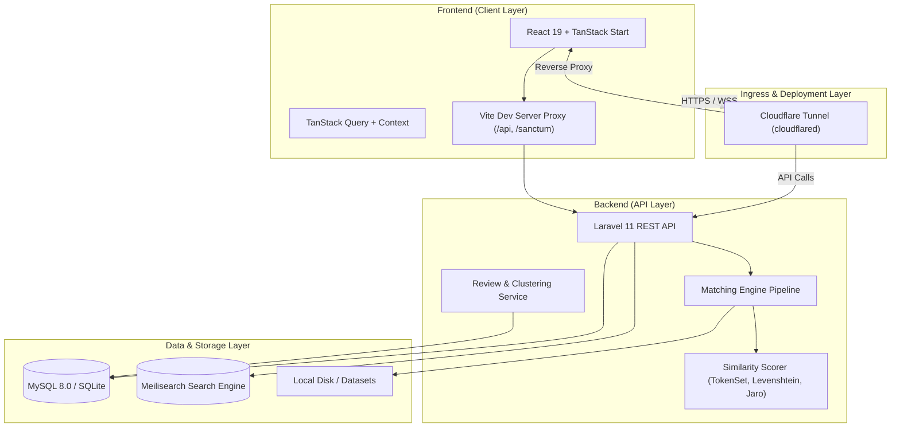

# RE-MATCH — Sistem Matching Data Entitas & Acuan

[](https://laravel.com)
[](https://react.dev)
[](https://tanstack.com)
[](https://tailwindcss.com)
[](https://www.meilisearch.com)
[](https://www.cloudflare.com)

**RE-MATCH** adalah platform pencocokan data (*entity resolution & record linkage*) modern berkinerja tinggi yang dirancang untuk membersihkan, mencocokkan, dan merekonsiliasi data entitas bisnis/perusahaan antara dataset input (Excel / CSV) dengan dataset master acuan (referensi).

Sistem ini memadukan mesin pencarian asinkronus berbasis **Meilisearch**, algoritma pencocokan berbobot (*Weighted Linear Combination Score* - WLS), aturan pelindung numerik (*numeric guardrails*), pohon keputusan (*decision tree*) preset konstruksi, antarmuka penelaahan manual (*manual review clustering*), serta ekspor multi-sheet ke Microsoft Excel dan CSV.

---

## 🚀 Fitur Unggulan

- **Mesin Pencarian Asinkronus & Candidate Pool 30 Kandidat:**
  Menggunakan Meilisearch untuk pencarian teks penuh (*full-text fuzzy indexing*) berkecepatan sub-milidetik, mengevaluasi hingga 30 kandidat teratas di latar belakang dan menyajikan 3 kandidat paling relevan ke pengguna.
- **Normalisasi Teks & Parsing Entitas:**
  Ekstraksi cerdas bentuk badan usaha (PT, CV, UD, Koperasi, Firma, Yayasan, BUMN) dan nama inti perusahaan untuk mencegah bias pencocokan akibat perbedaan penulisan legalitas.
- **Algoritma Fleksibel & Terkalibrasi:**
  Mendukung *Exact Match*, *Levenshtein Distance*, *Jaro-Winkler*, *Token Set Ratio*, *Token Sort Ratio*, serta pembobotan metrik (*Weighted Score*) dinamis.
- **Decision Tree & Guardrails Preset Konstruksi:**
  Pohon keputusan cerdas yang memvalidasi kemiripan kota/kabupaten serta mengarahkan entitas dengan nama dan alamat identik/mirip tinggi ($\ge 90\%$) namun beda wilayah administratif ke alur reviu manual.
- **Klastering & 6 Preset Reviu Otomatis:**
  Pengelompokan otomatis kasus ambiguitas ke dalam 6 kategori baku:
  1. *Konflik Identitas Legal / NIB*
  2. *Beda Bentuk Usaha (PT/CV)*
  3. *Kandidat Ganda (Ambiguitas Selisih Skor $\le 5\%$)*
  4. *Beda Wilayah (Kabupaten/Kota)*
  5. *Beda Alamat Jalan*
  6. *Nama & Alamat Sama, Beda Kabupaten/Kota*
  7. *Pola Dinamis & Aturan Kustom Heuristik*
- **Ekspor Cerdas Multi-Sheet XLSX & CSV:**
  Menyediakan opsi ekspor pemutakhiran master data dengan memisahkan hasil ke dalam sheet tersendiri: `Matched`, `New Entity (Unmatched)`, dan `Semua Data`.
- **UI Responsif & Aksesibilitas Terstandarisasi:**
  Dibangun dengan prinsip *Anti-Slop*, mikrokopi netral, kontras tinggi, navigasi keyboard penuh, dan visualisasi distribusi skor.

---

## 🏛️ Arsitektur Sistem



---

## 💻 Panduan Instalasi & Menjalankan Secara Lokal

### Prasyarat Sistem
- **Node.js**: Versi `v20.x` atau `v22.x` (LTS) & `npm`
- **PHP**: Versi `8.2` atau `8.3` dengan ekstensi: `pdo`, `pdo_mysql`, `pdo_sqlite`, `mbstring`, `openssl`, `curl`, `fileinfo`
- **Composer**: Versi `2.x`
- **Meilisearch**: Versi `v1.12+` (Binary lokal atau Docker)
- **Database**: MySQL `8.0+` atau SQLite

---

### Opsi 1: Menjalankan Menggunakan Docker Compose (Direkomendasikan)

Jika Anda memiliki Docker dan Docker Compose yang terpasang di komputer:

1. **Clone repositori:**
   ```bash
   git clone https://github.com/milzamf/rematch-matchingdata.git
   cd rematch-matchingdata
   ```

2. **Jalankan seluruh stack kontainer:**
   ```bash
   docker compose up -d
   ```
   *Stack ini secara otomatis menginisialisasi MySQL (port 3306), Meilisearch (port 7700), Laravel API (port 8000), Queue Worker, dan Frontend (port 8080 & 5173).*

3. **Migrasi dan inisialisasi database di dalam kontainer:**
   ```bash
   docker compose exec backend php artisan migrate --seed
   ```

4. **Buka aplikasi di peramban:**
   - Frontend: `http://localhost:8080`
   - Backend API: `http://localhost:8000/api`
   - Meilisearch: `http://localhost:7700`

---

### Opsi 2: Menjalankan Secara Manual (Native Local)

#### 1. Setup Backend (Laravel)

```bash
cd backend

# Salin file konfigurasi lingkungan
cp .env.example .env

# Instal dependensi PHP
composer install

# Buat application key
php artisan key:generate

# Konfigurasi database di .env (contoh SQLite atau MySQL lokal):
# DB_CONNECTION=sqlite (pastikan database/database.sqlite dibuat)
# atau gunakan MySQL lokal:
# DB_CONNECTION=mysql
# DB_HOST=127.0.0.1
# DB_PORT=3306
# DB_DATABASE=rematch
# DB_USERNAME=root
# DB_PASSWORD=

# Jalankan migrasi dan seeder
php artisan migrate --seed

# Jalankan server backend API
php artisan serve --port=8000
```

#### 2. Menjalankan Engine Meilisearch

Unduh binary Meilisearch untuk OS Anda (Windows/macOS/Linux), lalu jalankan pada port default `7700`:

```bash
# Windows PowerShell:
.\meilisearch.exe --master-key rematch_meili_master_key --http-addr 127.0.0.1:7700

# Linux / macOS:
./meilisearch --master-key rematch_meili_master_key --http-addr 127.0.0.1:7700
```

#### 3. Setup Frontend (React 19 + TanStack)

Buka terminal baru di direktori utama (*root*) repositori:

```bash
# Instal dependensi JavaScript
npm install

# Jalankan server pengembangan Vite
npm run dev
```

Aplikasi frontend akan aktif di `http://localhost:8080` atau `http://localhost:5173`. Seluruh permintaan API ke `/api/*` dan `/sanctum/*` akan diproksikan secara otomatis ke backend Laravel di `http://localhost:8000`.

---

## 🌐 Integrasi Cloudflare Tunnel

Cloudflare Tunnel (`cloudflared`) memungkinkan aplikasi **RE-MATCH** diakses secara publik dan aman melalui jaringan global Cloudflare dengan sertifikat SSL/TLS otomatis tanpa perlu membuka port (*port forwarding*) di router atau memiliki IP publik statis.

### 1. Instalasi CLI `cloudflared`

- **Windows (winget / choco):**
  ```powershell
  winget install --id Cloudflare.cloudflared
  # atau
  choco install cloudflared
  ```
- **macOS (Homebrew):**
  ```bash
  brew install cloudflared
  ```
- **Linux (Debian/Ubuntu):**
  ```bash
  curl -L --output cloudflared.deb https://github.com/cloudflare/cloudflared/releases/latest/download/cloudflared-linux-amd64.deb
  sudo dpkg -i cloudflared.deb
  ```

### 2. Autentikasi Cloudflare

```bash
cloudflared tunnel login
```
*Perintah ini akan membuka peramban untuk memilih domain Cloudflare Anda dan mengunduh sertifikat otorisasi (`cert.pem`).*

### 3. Membuat Tunnel

```bash
cloudflared tunnel create rematch-tunnel
```
*Simpan `Tunnel-ID` (UUID) yang dihasilkan.*

### 4. Konfigurasi `config.yml`

Buat berkas konfigurasi tunnel di `~/.cloudflared/config.yml` (atau `%USERPROFILE%\.cloudflared\config.yml` di Windows):

```yaml
tunnel: <TUNNEL_UUID_ANDA>
credentials-file: C:\Users\<USERNAME>\.cloudflared\<TUNNEL_UUID_ANDA>.json

ingress:
  # 1. Routing Domain Frontend (React / TanStack)
  - hostname: rematch.domainanda.com
    service: http://localhost:8080
    originRequest:
      noTLSVerify: false
      httpHostHeader: localhost:8080

  # 2. Routing Domain Backend API (Opsional jika ingin subdomain terpisah)
  # - hostname: api-rematch.domainanda.com
  #   service: http://localhost:8000

  # 3. Catch-all rule (Wajib di akhir)
  - service: http_status:404
```

### 5. Menghubungkan DNS Hostname ke Tunnel

```bash
cloudflared tunnel route dns rematch-tunnel rematch.domainanda.com
```

### 6. Menjalankan Cloudflare Tunnel

- **Mode Uji Coba Cepat (Quick Ad-hoc Tunnel):**
  ```bash
  cloudflared tunnel --url http://localhost:8080
  ```
- **Mode Produksi (Berbasis Berkas Konfigurasi):**
  ```bash
  cloudflared tunnel run rematch-tunnel
  ```
- **Menjalankan sebagai Background Service:**
  ```bash
  cloudflared service install
  cloudflared service start
  ```

---

## 🧪 Pengujian & Verifikasi Kualitas

Repositori dilengkapi rangkaian pengujian unit dan fitur komprehensif:

```bash
# Menjalankan seluruh pengujian backend (PHPUnit)
cd backend
php artisan test

# Menjalankan pengujian spesifik pohon keputusan matching
php artisan test tests/Feature/PresetKonstruksiDecisionTreeTest.php

# Menjalankan pengujian hirarki aturan review
php artisan test tests/Feature/ReviewRulesHierarchyTest.php

# Memeriksa kompilasi frontend dan tipe data TypeScript
cd ..
npm run build
```

---

## 📄 Lisensi & Kontribusi

Proyek ini dikembangkan untuk kebutuhan standardisasi matching data dan rekonsiliasi entitas bisnis. Seluruh hak cipta dilindungi undang-undang.
