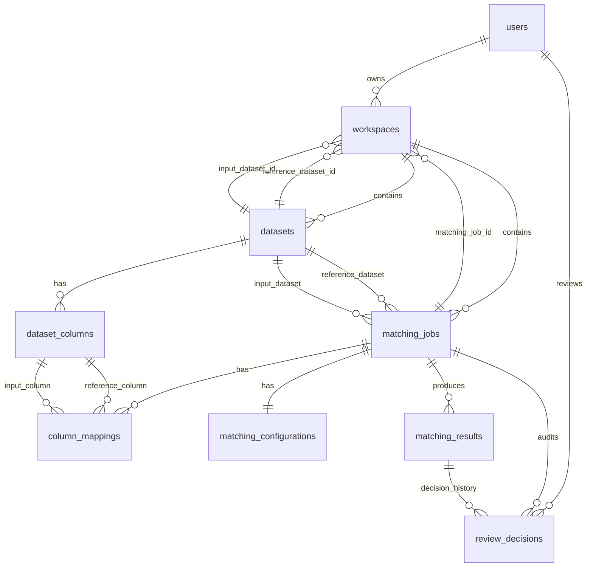

# RE-MATCH Database Design

### Snapshot hasil baru (19 Oktober 2026, belum dimigrasikan ke utama)

Migrasi additive `2026_10_19_000001_create_matching_record_snapshots.php` menambah tabel InnoDB `matching_record_snapshots` (PK SHA-256 64 karakter, payload lossless, created_at). Acuan asli disimpan berdasarkan hash; kolom generated adalah overlay terpisah pada kandidat. Input tetap tersedia sekali pada rank 1, kandidat lain memakai pointer string dalam job yang sama. Format inline lama tetap dibaca. Pembaca memverifikasi hash, koneksi, dan identitas input, serta memuat snapshot dalam batch halaman terbatas. Batas payload acuan 2 MiB/baris, 16 MiB per batch hydration. JSON pointer tidak mempunyai FK fisik; engine menerbitkan snapshot sebelum hasil/checkpoint, dan resume menolak dependensi hilang. `down()` menolak menghapus tabel yang masih direferensikan. Tidak melakukan pemadatan atau perubahan data historis.

### Tahap 3 reconciliation schema (2026-10-13, isolated only)

Approved additive migration `2026_10_13_000003_create_review_reconciliation_holds.php`
adds issue evidence and neutral resource reservations. Active review assignment is
generated only for matched/consistent states; all conflicting inputs can be held
without selecting an owner. Dataset-scoped verified membership is snapshotted;
assignment/holds remain per job. The next concurrency service must lock/check holds
as well as assignments; cross-table protection is not automatic. Main DB remains
unmigrated. Details, test results and rollback guards: REVIEW_BACKFILL_STAGE3.md.

### Compact verification evidence (2026-10-12)

Extended compact score storage: `field_scores` keeps the SQL-readable reference/input column names and scores; full explanations (weights, algorithms, identity/address evidence) live losslessly in `candidate_metadata._field_scores`. MatchingResult exposes the original field array. Short records keep the original format when an envelope would grow them. Migration `2026_10_12_000002_drop_redundant_matching_result_indexes.php` removes four left-prefix indexes already covered by the existing unique/covering indexes; rollback restores them. Historical compaction updates payload columns only and preserves IDs, status, scores, timestamps, and review links.

Extended compact score storage: `field_scores` keeps the SQL-readable reference/input column names and scores; full explanations (weights, algorithms, identity/address evidence) live losslessly in `candidate_metadata._field_scores`. MatchingResult exposes the original field array. Short records keep the original format when an envelope would grow them. Migration `2026_10_12_000002_drop_redundant_matching_result_indexes.php` removes four left-prefix indexes already covered by the existing unique/covering indexes; rollback restores them. Historical compaction updates payload columns only and preserves IDs, status, scores, timestamps, and review links.

New matching results store lossless JSON or `gz1:` gzip/base64 evidence in `candidate_metadata._verification_evidence`; the physical `verification_evidence` column is null. The model accessor and review API expose the same decoded array and still read historical JSON columns. Direct SQL consumers must decode the metadata payload for new rows. Field scores, source records, and indexes remain queryable in their original formats. SQLite checkpoint `results_json` supports both legacy JSON and compressed payloads. No schema migration or rewriting of historical results occurs.

2026-10-12 review filters: migration `2026_10_12_000001_add_review_region_and_score_indexes.php` adds nullable `input_province_code`, nullable `input_regency_code`, and `input_region_indexed` (false until prepared). Only rank-1 candidates need these input-region facets. New matching results resolve them through MFD; `BuildReviewRegionIndex` backfills older rows in batches of 500 under a connection-owned MySQL advisory lock. Backfill changes only these three columns and preserves matching evidence and decisions.

- `review_score_idx`: `(matching_job_id, candidate_rank, overall_score, input_record_key)` for narrow score/key projection.
- `review_region_idx`: `(matching_job_id, candidate_rank, input_province_code, input_regency_code, overall_score)` for canonical region predicates.
- `review_region_ready_idx`: `(matching_job_id, candidate_rank, input_region_indexed, id)` for preparation readiness and batch traversal.

Selected-candidate scores are overlaid using a narrow union of primary scores and reviewer choices before pagination. EXPLAIN on the 133,524-input job used the score/region indexes and the existing job/input/rank index. Sorting the union still uses a filesort over narrow scalar rows; it does not hydrate all candidate JSON in PHP. First installation on the existing ~1.2M-result table took about five minutes to add columns/indexes; this is a migration cost, not a per-request operation.

Status: actual schema updated through Milestone 9.5.1. This document now separates the current implemented schema from future target entities that are still deferred.

2026-10-11 review optimization: migration `2026_10_11_000001_add_review_pagination_covering_index.php` adds `matching_results_review_page_cover_idx` on `(matching_job_id, candidate_rank, result_type, id, input_record_key)`. It covers status-filtered ordered pagination and key projection without fetching large JSON payloads for skipped rows. No result or decision data is changed.

## 1. Current Implemented Schema

Implemented tables in migrations today:

- `users`
- `password_reset_tokens`
- `sessions`
- `datasets`
- `dataset_columns`
- `matching_jobs`
- `column_mappings`
- `matching_configurations`
- `matching_results`
- `review_decisions`
- `workspaces`

Current ownership path:

- `users -> workspaces`
- `workspaces -> datasets`
- `workspaces -> matching_jobs`
- `matching_jobs -> matching_results`
- `matching_jobs` and optionally `matching_results -> review_decisions`

Current implemented schema intentionally does **not** include migrations for:

- `workspace_users`
- `sync_plans`
- `exports`
- `audit_logs`
- `ai_recommendations`

## 2. Current Implemented Tables

| Table | Current purpose |
| --- | --- |
| `users` | Authenticated RE-MATCH users with role-based access |
| `datasets` | Uploaded/inspected dataset metadata and profiling snapshot |
| `dataset_columns` | Per-column schema/profiling facts for a dataset |
| `matching_jobs` | Matching run header and processing status |
| `column_mappings` | Saved reference/input field mappings used by a matching job |
| `matching_configurations` | One configuration snapshot per matching job |
| `matching_results` | Candidate results and current review state per input record |
| `review_decisions` | Human review decision history with optional reviewer attribution |
| `workspaces` | Resumable workflow session linking datasets and matching job |

## 3. Current Implemented Relationships

## 4. Current Implemented Table Notes

| Table | Key fields |
| --- | --- |
| `users` | `id`, `name`, `email`, `role`, `password`, `email_verified_at`, timestamps |
| `datasets` | `id`, `workspace_id`, `dataset_role`, `name`, `original_filename`, `file_format`, `storage_path`, `selected_sheet`, `delimiter`, `header_row`, `row_count`, `column_count`, `parse_status`, `sheet_names`, `preview_rows`, `profiling_summary`, timestamps |
| `dataset_columns` | `id`, `dataset_id`, `name`, `normalized_name`, `data_type`, `position`, `null_count`, `null_percentage`, `unique_count`, `duplicate_percentage`, `sample_values`, timestamps |
| `matching_jobs` | `id`, `workspace_id`, `reference_dataset_id`, `input_dataset_id`, `name`, `status`, `processed_count`, `total_count`, `record_counts`, `error_message`, `started_at`, `finished_at`, timestamps |
| `column_mappings` | `id`, `matching_job_id`, `reference_column_id`, `input_column_id`, `reference_column_name`, `input_column_name`, `algorithm`, `weight`, `required_match`, `metadata`, timestamps |
| `matching_configurations` | `id`, `matching_job_id`, `preset`, `strategy`, `thresholds`, `normalization`, `search_optimization`, `candidate_generation`, `output_config`, `advanced_settings`, `config_hash`, timestamps |
| `matching_results` | `id`, `matching_job_id`, `input_record_key`, `reference_record_key`, `result_type`, `review_status`, `review_decision`, `reviewed_at`, `overall_score`, `candidate_rank`, `field_scores`, `candidate_metadata`, `decision_reason`, timestamps |
| `review_decisions` | `id`, `matching_job_id`, `matching_result_id`, `reviewer_user_id`, `input_record_key`, `selected_reference_record_key`, `decision`, `previous_result_type`, `new_result_type`, `metadata`, `undone_at`, timestamps |
| `workspaces` | `id`, `user_id`, `name`, `status`, `current_step`, `reference_dataset_id`, `input_dataset_id`, `matching_job_id`, `workflow_state`, `sync_state`, `export_history`, timestamps |

## 5. Current Ownership Rule

- Ownership root is `workspaces.user_id`
- `datasets.workspace_id` and `matching_jobs.workspace_id` now anchor child ownership directly to workspace
- `matching_results` derive ownership from `matching_job_id -> matching_jobs.workspace_id`
- `review_decisions` derive ownership from `matching_job_id` and optionally `matching_result_id`
- No direct `user_id` is added to datasets, jobs, results, or decisions for ownership

## 6. Future / Target Entities

These entities are still part of the broader target architecture, but they are **not implemented in migrations yet**:

- `workspace_users`
- `sync_plans`
- `exports`
- `audit_logs`
- `ai_recommendations`

They remain valid future design directions, but must not be treated as current schema.

## 7. Current Implemented Vertical Slice

- `datasets` stores inspected CSV/XLSX upload metadata, selected sheet/delimiter/header row, row/column counts, preview rows, and profiling summary
- `dataset_columns` stores detected column type, position, null count/percentage, unique count, duplicate percentage, and sample values
- `workspaces` stores resumable workflow sessions with linked reference/input datasets, matching job, current step, status, and compact workflow snapshot
- `matching_jobs` now also store nullable `workspace_id` for direct ownership anchoring
- `datasets` now also store nullable `workspace_id` for direct ownership anchoring
- `review_decisions` now support nullable `reviewer_user_id` for reviewer attribution
- Current workspace delete removes only the workspace/session row. Linked datasets, matching jobs, and reference data are not deleted by workspace delete
- Current implemented auth metadata adds `users.role` with allowed values `admin`, `user`, and `pimpinan`
- Admin owner reassignment currently rebinds linked workspace, dataset, and matching job ownership together

## Database Normalization & Integrity Audit

Audit scope: actual migrations and models as of 2026-08-13, plus `ResourceOwnership`. This section reflects the implemented schema, not the earlier target design above.

### Current Normalization Status

- Core transactional tables are mostly in 3NF.
- Several tables are naturally close to BCNF where one row represents one entity or one parent-owned child fact.
- Controlled denormalization is already used intentionally in JSON snapshot/evidence columns and should remain.
- The main integrity gap is not basic normalization. It is ownership traceability and missing constraints around parent-child uniqueness.

### Actual Ownership Shape

- `users` owns `workspaces` directly through `workspaces.user_id`
- `datasets.workspace_id` and `matching_jobs.workspace_id` now anchor child ownership directly to workspace
- `matching_results` continue to derive ownership through `matching_job_id -> matching_jobs.workspace_id`
- `review_decisions` continue to derive ownership through `matching_job_id` and optionally `matching_result_id`
- The schema now aligns better with `User -> Workspace -> child workflow resources` without adding redundant direct `user_id` to child workflow tables

### Table Audit Summary

#### `users`

- PK: `id`
- UNIQUE: `email`
- Other notable columns: `role`, `email_verified_at`, `password`
- Normalization:
  - 1NF: yes, scalar values only
  - 2NF: yes, single-column PK
  - 3NF: yes, non-key attributes depend on `id`
  - BCNF: yes for current scope, assuming `email` is the only alternate key
- Notes:
  - `role` is controlled by application enum, not DB constraint
  - `email_verified_at` depends on the user entity, not on another non-key attribute

#### `datasets`

- PK: `id` (UUID)
- FK: `workspace_id -> workspaces.id` `nullOnDelete`
- Indexes: (`dataset_role`, `parse_status`), `file_format`, `created_at`
- JSON: `sheet_names`, `preview_rows`, `profiling_summary`
- Normalization:
  - 1NF: relationally yes; JSON columns are intentional structured blobs
- 2NF: yes, single-column PK
- 3NF: mostly yes; file metadata and profiling snapshot depend on dataset identity
- BCNF: acceptable if one dataset row represents one uploaded/inspected artifact
- Notes:
  - `workspace_id` is nullable for migration/backfill compatibility
  - `preview_rows` and `profiling_summary` are intentional denormalization for auditability/performance

#### `dataset_columns`

- PK: `id` (UUID)
- FK: `dataset_id -> datasets.id` `cascadeOnDelete`
- Indexes: (`dataset_id`, `normalized_name`), (`dataset_id`, `position`)
- JSON: `sample_values`
- Normalization:
  - 1NF: mostly yes; `sample_values` is intentional denormalization
  - 2NF: yes
  - 3NF: mostly yes; profiling metrics depend on the column within a dataset
  - BCNF: not fully guaranteed because the natural determinant should be at least (`dataset_id`, `position`) or (`dataset_id`, `name`)
- Notes:
  - UNIQUE (`dataset_id`, `position`) is now implemented
  - Repeated normalized names may still be possible if source headers collide intentionally

#### `matching_jobs`

- PK: `id` (UUID)
- FK:
  - `workspace_id -> workspaces.id` `nullOnDelete`
  - `reference_dataset_id -> datasets.id` `cascadeOnDelete`
  - `input_dataset_id -> datasets.id` `cascadeOnDelete`
- Indexes: (`status`, `created_at`), `reference_dataset_id`, `input_dataset_id`
- JSON: `record_counts`
- Normalization:
  - 1NF: yes, with intentional JSON snapshot
- 2NF: yes
- 3NF: yes; job progress/status facts depend on the job
- BCNF: broadly yes
- Notes:
  - `workspace_id` is nullable for migration/backfill compatibility
  - Existing `workspaces.matching_job_id` is preserved for workflow compatibility

#### `column_mappings`

- PK: `id` (UUID)
- FK:
  - `matching_job_id -> matching_jobs.id` `cascadeOnDelete`
  - `reference_column_id -> dataset_columns.id` `nullOnDelete`
  - `input_column_id -> dataset_columns.id` `nullOnDelete`
- Indexes: `matching_job_id`, `reference_column_id`, `input_column_id`
- JSON: `metadata`
- Normalization:
  - 1NF: yes, with intentional JSON metadata
  - 2NF: yes
  - 3NF: mixed
  - BCNF: no
- Functional dependency concern:
  - If `reference_column_id` is present, then `reference_column_name` is derivable from `dataset_columns.name`
  - If `input_column_id` is present, then `input_column_name` is derivable from `dataset_columns.name`
  - Therefore `reference_column_name` and `input_column_name` are redundant when FK columns are non-null
- Classification:
  - KEEP as intentional denormalization for audit snapshot and resilience after `nullOnDelete`
- Notes:
  - UNIQUE (`matching_job_id`, `reference_column_name`) is now implemented to prevent duplicate reference-field mappings inside one job
  - Current design mixes normalized references with snapshot names intentionally

#### `matching_configurations`

- PK: `id` (UUID)
- FK: `matching_job_id -> matching_jobs.id` `cascadeOnDelete`
- UNIQUE: `matching_job_id`
- Index: `config_hash`
- JSON:
  - `thresholds`
  - `normalization`
  - `search_optimization`
  - `candidate_generation`
  - `output_config`
  - `advanced_settings`
- Normalization:
  - 1NF: acceptable with intentional JSON configuration document
  - 2NF: yes
  - 3NF: yes for a one-row-per-job configuration snapshot
  - BCNF: acceptable because `matching_job_id` is a unique alternate key
- Classification:
  - KEEP as intentional denormalization

#### `matching_results`

- PK: `id` (UUID)
- FK: `matching_job_id -> matching_jobs.id` `cascadeOnDelete`
- Indexes:
  - (`matching_job_id`, `result_type`)
  - (`matching_job_id`, `input_record_key`)
  - (`matching_job_id`, `overall_score`)
  - (`matching_job_id`, `review_status`)
- JSON: `field_scores`, `candidate_metadata`
- Normalization:
  - 1NF: acceptable with intentional evidence JSON
  - 2NF: yes
  - 3NF: mixed but acceptable
  - BCNF: not guaranteed because candidate rows are effectively identified by business facts such as (`matching_job_id`, `input_record_key`, `candidate_rank`) or (`matching_job_id`, `input_record_key`, `reference_record_key`)
- Notes:
  - UNIQUE (`matching_job_id`, `input_record_key`, `candidate_rank`) is now implemented
  - Missing uniqueness or partial constraint to prevent duplicate candidate rows per input/reference pair
  - `review_decision` and `reviewed_at` duplicate latest-review state from `review_decisions`, but this is acceptable as current-state cache
- Classification:
  - KEEP review-state columns as intentional denormalization for fast workflow reads

#### `review_decisions`

- PK: `id` (UUID)
- FK:
  - `matching_job_id -> matching_jobs.id` `cascadeOnDelete`
  - `matching_result_id -> matching_results.id` `nullOnDelete`
  - `reviewer_user_id -> users.id` `nullOnDelete`
- Indexes: (`matching_job_id`, `input_record_key`), (`matching_job_id`, `decision`)
- JSON: `metadata`
- Normalization:
  - 1NF: acceptable with intentional metadata JSON
  - 2NF: yes
  - 3NF: yes if each row is one decision event
  - BCNF: broadly yes
- Notes:
  - `matching_result_id` nullable is valid because decision history can outlive a deleted candidate row
  - `reviewer_user_id` is nullable for historical rows and history retention

#### `workspaces`

- PK: `id` (UUID)
- FK:
  - `user_id -> users.id` `nullOnDelete`
  - `reference_dataset_id -> datasets.id` `nullOnDelete`
  - `input_dataset_id -> datasets.id` `nullOnDelete`
  - `matching_job_id -> matching_jobs.id` `nullOnDelete`
- Indexes: `status`, `current_step`, `updated_at`, (`user_id`, `status`)
- JSON: `workflow_state`, `sync_state`, `export_history`
- Normalization:
  - 1NF: acceptable with intentional JSON workflow snapshots
  - 2NF: yes
  - 3NF: mixed but acceptable
  - BCNF: not strict because snapshot columns embed multi-concern state by design
- Notes:
  - `workflow_state`, `sync_state`, and `export_history` are intentional denormalization
  - `nullOnDelete` on `user_id` means a workspace can survive without owner
  - This may be operationally acceptable but creates ownership-orphan risk

### Key Integrity Issues

1. **Documentation drift from actual schema**  
   - Priority: HIGH  
   - Classification: KEEP schema / fix docs  
   - `docs/DATABASE.md` still states direct owner columns on `datasets` and `matching_jobs`, but actual migrations only add `workspaces.user_id`

2. **Ownership enforcement is still mixed between direct and derived paths**  
   - Priority: MEDIUM  
   - Classification: KEEP / NORMALIZE LATER  
   - `datasets` and `matching_jobs` now carry `workspace_id`
   - `matching_results` and `review_decisions` still derive ownership through `matching_job_id`

3. **`dataset_columns` natural-key coverage is improved but still partial**  
   - Priority: LOW  
   - Classification: KEEP / ADD CONSTRAINT LATER  
   - (`dataset_id`, `position`) is now unique
   - Duplicate normalized names are still possible when source headers collide

4. **`matching_results` candidate-level uniqueness is only partially enforced**  
   - Priority: LOW  
   - Classification: KEEP / ADD CONSTRAINT LATER  
   - (`matching_job_id`, `input_record_key`, `candidate_rank`) is now unique
   - Duplicate pairs by `reference_record_key` are still theoretically possible under different ranks

5. **`column_mappings` uniqueness now depends on reference snapshot name**  
   - Priority: LOW  
   - Classification: KEEP  
   - This is aligned with current workflow rules where one reference field is mapped once per job

6. **`workspaces.user_id` uses `nullOnDelete`**  
   - Priority: MEDIUM  
   - Classification: ADD CONSTRAINT / KEEP depending on retention policy  
   - Prevents destructive cascade, but can leave ownerless workspaces

7. **Missing ownership-path indexes for derived access control**  
   - Priority: MEDIUM  
   - Classification: ADD INDEX  
   - Current permission scoping repeatedly traverses `workspaces(user_id, reference_dataset_id, input_dataset_id, matching_job_id)`

8. **No FK from `matching_results.reference_record_key` or `input_record_key`**  
   - Priority: LOW  
   - Classification: KEEP  
   - Acceptable because record keys refer to row-level source data, not normalized entity tables

### Intentional Denormalization To Keep

- `datasets.sheet_names`
- `datasets.preview_rows`
- `datasets.profiling_summary`
- `dataset_columns.sample_values`
- `column_mappings.reference_column_name`
- `column_mappings.input_column_name`
- `column_mappings.metadata`
- `matching_configurations.*json`
- `matching_jobs.record_counts`
- `matching_results.field_scores`
- `matching_results.candidate_metadata`
- `matching_results.review_decision` and `reviewed_at` as latest-state cache
- `review_decisions.metadata`
- `workspaces.workflow_state`
- `workspaces.sync_state`
- `workspaces.export_history`

These are justified for auditability, replay, evidence preservation, and avoiding expensive reconstruction from source files or review history.

### Recommended Fixes

1. **MEDIUM — ADD INDEX**  
   Add indexes that match ownership traversal and common admin/review access patterns, especially around workspace-linked dataset/job lookup.

2. **MEDIUM — ADD CONSTRAINT or POLICY**  
   Decide whether ownerless workspaces are valid. If not, replace `nullOnDelete` ownership behavior with an explicit reassignment/archive policy.

3. **LOW — ADD CONSTRAINT LATER**  
   Evaluate whether `dataset_columns` also needs uniqueness on (`dataset_id`, `normalized_name`) or (`dataset_id`, `name`) based on real-world duplicate-header handling.

4. **LOW — ADD CONSTRAINT LATER**  
   Evaluate whether `matching_results` also needs uniqueness on (`matching_job_id`, `input_record_key`, `reference_record_key`) when `reference_record_key` is not null.

## Tahap 2 review foundation (2026-10-13)

Prepared additive migrations for review_states, review_operations,
review_change_requests, workspace_members, reference_entity_groups and
reference_entity_members; workspace configuration version, job readiness/schema
version and nullable review audit links/actors/versions. Generated assignment,
canonical and pending columns support MySQL 8 uniqueness and referential integrity.

Not applied to the user's database; no historical backfill or application cutover.
Existing status/history remain authoritative. See [REVIEW_SCHEMA_STAGE2.md](REVIEW_SCHEMA_STAGE2.md)
for exact constraints, rollback guards, verification and remaining service responsibilities.
## Derived review score projection (2026-10-13, additive and unapplied to main)

Migration `2026_10_13_000004` adds nullable decimal(5,2) display_score, display_score_indexed=false and stored display_score_null to review_states, four job/status/all score-direction/key indexes plus readiness index. MySQL BEFORE INSERT/UPDATE triggers project the actual selected candidate or rank-1 score with exact opaque-key verification; all changes share the state transaction. Existing states are not updated by migration; reader retains join fallback until projection ready. No new source decision/version/history or algorithm. Rollback drops derived triggers/indexes/columns only; disable new reader first. See SHARED_WORKSPACE_INTEGRATION_QA.md.

## UAT region count index (2026-10-14, unapplied to main)

Migration `2026_10_14_000001` adds `shared_region_count_idx` on matching_results(job, rank, input province, input regency, input key). Shared region counts use a covered primary-candidate scan then exact binary state-key lookups, independently of score ordering. It adds disk/write cost and must be deployed before the new region-count reader; down removes only this derived index. No columns, candidate scores, historical decisions or main data are changed. See WORKSPACE_SHARING_CUTOVER_UAT.md for rehearsal results and activation gates.
