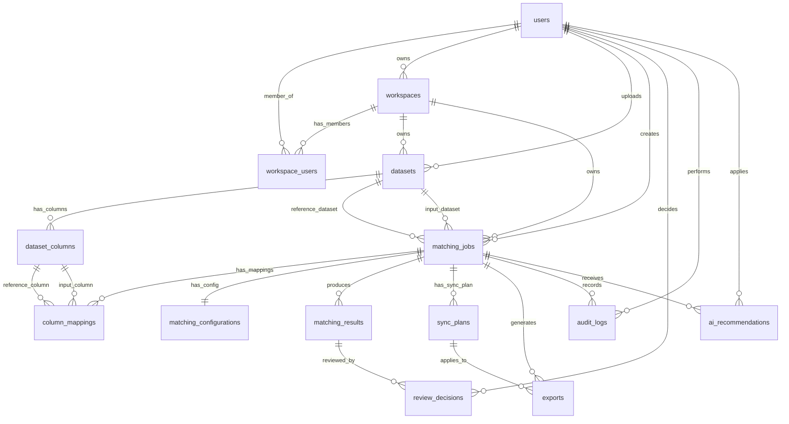

# BatchMatch Database Design

Status: Initial database design draft. Implemented MVP slices now include `datasets`, `dataset_columns`, matching/review tables, and `workspaces` for session persistence.

## 1. Database Overview

BatchMatch uses the database to store users, workspaces, uploaded dataset metadata, profiling output, matching jobs, configuration, results, review decisions, synchronization plans, exports, AI recommendations, and audit history.

Raw uploaded files and generated exports should be stored in object/file storage. The database stores file references, schema metadata, job state, and structured JSON summaries where the shape may vary by file type or matching strategy.

The design must support MySQL or PostgreSQL through Laravel migrations later. Every operational record must be scoped to a workspace and, where relevant, the user who created or acted on it.

## 2. Main Entities

| Table | Purpose |
| --- | --- |
| `users` | Authenticated BatchMatch users. |
| `workspaces` | Tenant boundary for jobs, uploads, exports, and audit history. |
| `workspace_users` | User membership and role inside a workspace. |
| `datasets` | Uploaded or generated dataset metadata. |
| `dataset_columns` | Column profile and inferred schema for each dataset. |
| `matching_jobs` | Main workflow instance from Upload to Export. |
| `column_mappings` | Selected reference/input column pairs and algorithms. |
| `matching_configurations` | Preset, thresholds, normalization, search optimization, and output settings. |
| `matching_results` | Matched, possible match, unmatched, and conflict candidates. |
| `review_decisions` | Manual reviewer decisions for possible matches or conflicts. |
| `sync_plans` | Merge/synchronization strategy selected before export. |
| `exports` | Generated output files and export history. |
| `audit_logs` | Immutable activity trail for compliance and traceability. |
| `ai_recommendations` | Optional AI suggestions and whether users applied or ignored them. |

## 3. Mermaid ERD

## 4. Table Descriptions

| Table | Key fields |
| --- | --- |
| `users` | `id`, `full_name`, `username`, `email`, `role`, `password_hash`, `status`, timestamps. |
| `workspaces` | `id`, future `owner_user_id`, `name`, `status`, `current_step`, `reference_dataset_id`, `input_dataset_id`, `matching_job_id`, `workflow_state`, `sync_state`, `export_history`, timestamps. |
| `workspace_users` | `workspace_id`, `user_id`, `role`, `status`, timestamps. |
| `datasets` | `id`, `workspace_id`, `uploaded_by_user_id`, `name`, `dataset_role`, `source_type`, `file_format`, `storage_path`, `row_count`, `column_count`, `parse_status`, `schema_snapshot_json`, `profiling_summary_json`, timestamps. |
| `dataset_columns` | `id`, `dataset_id`, `name`, `normalized_name`, `data_type`, `position`, `null_rate`, `unique_count`, `duplicate_rate`, `pattern`, `stats_json`. |
| `matching_jobs` | `id`, `workspace_id`, `created_by_user_id`, `reference_dataset_id`, `input_dataset_id`, `status`, `current_step`, `record_counts_json`, `started_at`, `finished_at`, timestamps. |
| `column_mappings` | `id`, `matching_job_id`, `reference_column_id`, `input_column_id`, `algorithm`, `weight`, `required_match`, `normalization_rule`. |
| `matching_configurations` | `id`, `matching_job_id`, `preset`, `strategy`, `thresholds_json`, `normalization_json`, `search_optimization_json`, `candidate_generation_json`, `output_config_json`, `advanced_settings_json`, `config_hash`. |
| `matching_results` | `id`, `workspace_id`, `matching_job_id`, `reference_record_key`, `input_record_key`, `result_type`, `overall_score`, `field_scores_json`, `decision_reason`, `candidate_rank`, timestamps. |
| `review_decisions` | `id`, `workspace_id`, `matching_job_id`, `matching_result_id`, `reviewer_user_id`, `decision`, `notes`, `decided_at`. |
| `sync_plans` | `id`, `workspace_id`, `matching_job_id`, `created_by_user_id`, `matched_action`, `unmatched_action`, `possible_action`, `conflict_action`, `summary_json`, `status`, timestamps. |
| `exports` | `id`, `workspace_id`, `matching_job_id`, `sync_plan_id`, `requested_by_user_id`, `format`, `scope`, `storage_path`, `status`, `generated_at`, timestamps. |
| `audit_logs` | `id`, `workspace_id`, `user_id`, `matching_job_id`, `entity_type`, `entity_id`, `action`, `metadata_json`, `created_at`. |
| `ai_recommendations` | `id`, `workspace_id`, `matching_job_id`, `dataset_id`, `target_type`, `target_id`, `recommendation_type`, `payload_json`, `confidence`, `status`, `applied_by_user_id`, timestamps. |

## 5. Key Relationships

- A user may belong to many workspaces through `workspace_users`.
- A workspace owns datasets, matching jobs, results, review decisions, sync plans, exports, audit logs, and AI recommendations.
- A matching job connects one reference dataset and one input dataset, then owns mappings, configuration, results, sync plans, exports, and audit entries.
- `column_mappings` links profiled columns from both datasets and stores the selected algorithm/weight for each pair.
- `matching_results` can receive one or more `review_decisions` so review history remains traceable.
- `sync_plans` define what happens after review: skip matched records, append unmatched records, handle possible matches, and resolve conflicts.
- AI recommendations are optional and reviewable. They must never overwrite user choices without confirmation, and applied recommendations should be recorded in `audit_logs`.

## 6. Ownership Rule

Every job, dataset, result, export, and audit log belongs to a workspace and is attributable to a user where applicable.

- Workspace ownership is enforced with `workspace_id` on operational tables.
- User attribution is stored with fields such as `created_by_user_id`, `uploaded_by_user_id`, `requested_by_user_id`, `reviewer_user_id`, and `user_id`.
- API queries must always filter by the active workspace and authenticated user membership.
- Cross-workspace access is not allowed, including files, exports, review history, AI recommendations, and audit trail records.

## 7. Suggested Indexes

| Table | Suggested indexes |
| --- | --- |
| `users` | Unique `email`, unique `username`. |
| `workspaces` | Unique `slug`, `owner_user_id`. |
| `workspace_users` | Unique (`workspace_id`, `user_id`), `user_id`, `role`. |
| `datasets` | (`workspace_id`, `parse_status`), (`workspace_id`, `uploaded_by_user_id`), (`workspace_id`, `file_format`). |
| `dataset_columns` | (`dataset_id`, `normalized_name`), (`dataset_id`, `position`). |
| `matching_jobs` | (`workspace_id`, `status`, `created_at`), (`created_by_user_id`, `created_at`), `reference_dataset_id`, `input_dataset_id`. |
| `column_mappings` | `matching_job_id`, `reference_column_id`, `input_column_id`. |
| `matching_configurations` | Unique `matching_job_id`, `config_hash`. |
| `matching_results` | (`workspace_id`, `matching_job_id`, `result_type`), (`matching_job_id`, `overall_score`), (`matching_job_id`, `input_record_key`), (`matching_job_id`, `reference_record_key`). |
| `review_decisions` | (`workspace_id`, `matching_job_id`), `matching_result_id`, (`reviewer_user_id`, `decided_at`). |
| `sync_plans` | (`workspace_id`, `matching_job_id`, `status`). |
| `exports` | (`workspace_id`, `matching_job_id`, `status`), (`requested_by_user_id`, `created_at`). |
| `audit_logs` | (`workspace_id`, `created_at`), (`user_id`, `created_at`), (`entity_type`, `entity_id`), (`matching_job_id`, `created_at`). |
| `ai_recommendations` | (`workspace_id`, `matching_job_id`, `recommendation_type`), (`target_type`, `target_id`), `status`. |

## 8. Migration Order

1. `users`
2. `workspaces`
3. `workspace_users`
4. `datasets`
5. `dataset_columns`
6. `matching_jobs`
7. `column_mappings`
8. `matching_configurations`
9. `matching_results`
10. `review_decisions`
11. `sync_plans`
12. `exports`
13. `ai_recommendations`
14. `audit_logs`

This order creates parent records before dependent records. `audit_logs` should be last because it references activity across multiple domain entities.

## Implemented Vertical Slice

- `datasets` stores inspected CSV/XLSX upload metadata, selected sheet/delimiter/header row, row/column counts, preview rows, and profiling summary.
- `dataset_columns` stores detected column type, position, null count/percentage, unique count, duplicate percentage, and sample values.
- `workspaces` stores resumable workflow sessions with linked reference/input datasets, matching job, current step, status, and compact workflow snapshot.
- Current workspace delete removes only the workspace/session row. Linked datasets, matching jobs, and reference data are not deleted by workspace delete.
- User ownership and workspace membership enforcement are deferred until the Workspace Ownership milestone.
- Current implemented auth metadata adds `users.role` with allowed values `admin`, `user`, and `pimpinan`.
