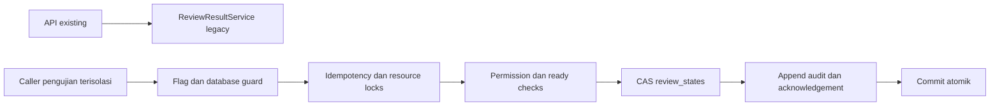

# RE-MATCH — Tahap 4: transaksi review dengan concurrency

2026-10-13. Implementasi/pengujian selesai **hanya di lingkungan terisolasi**.
Database utama, route, controller, frontend dan jalur review aktif tidak diubah.
Tidak ada migration baru, historical backfill, cutover, sharing atau approval activation.

## 1. Audit dan file

Dokumen kontrak Tahap 1, schema Tahap 2 dan laporan backfill Tahap 3 diperiksa ulang.
Enam foundation tables, dua ledger integrity, version columns dan audit links cukup;
tidak membuat tabel mutex, assignment atau histori duplikat. Skema Tahap 3 tetap
dataset-scoped untuk verified entities; assignment unik tetap job-scoped.

ReviewResultService existing mengunci matching_results target, kemudian mengubah
result_type dan menambahkan review_decisions; Undo mengubah undone_at/status lama.
Belum ada CAS/idempotency/append-only Undo pada jalur tersebut. Jalur lama sengaja
dipertahankan selama cutover belum disetujui; jaminan baru belum berlaku pada web live.

Ditambahkan:

- `backend/app/Services/Matching/Transactions/ReviewTransactionService.php`
- `backend/app/Services/Matching/Transactions/ReviewWriteConflict.php`
- `backend/config/review_transactions.php`
- `backend/scripts/test_review_transactions_mysql.php`
- `backend/tests/Unit/ReviewTransactionBoundaryTest.php`
- `docs/REVIEW_TRANSACTIONS_STAGE4.md`, `docs/REVIEW_STAGE4_BENCHMARK.json`.

Diubah: ARCHITECTURE, SESSION, IMPLEMENTATION_STATUS, CHANGELOG untuk milestone ini.
Tidak mengubah ReviewResultService, controller/request/route, similarity atau migrasi.

## 2. Arsitektur dan kontrak service

Service menerima koneksi MySQL dan actor terautentikasi dari backend, bukan actor ID
dari body frontend. Dua operasi publik: `decide` dan `undo`. Core memakai scalar state,
candidate ID/key, permission registry existing dan ledger; tidak membaca dataset penuh,
field-score explanations, menghitung similarity, atau memperluas filter kelompok.

Item eksplisit: string `input_record_key`, integer positif `expected_version`,
decision, dan candidate_id bila diperlukan. Tidak cast/trim/lower/rekey. `001` dan `1`
tetap berbeda. UUID job/candidate harus cocok dengan bentuk identitas yang tersimpan.
Idempotency key string dibatasi 128 byte; input key 255 byte; maksimum 50 input/op.
Fields tidak dikenal/tipe salah ditolak. Request hash mencakup actor/job/mode dan
item yang diurutkan deterministik; ordinal item tidak mengubah maksud request.

Decision mapping accept/select -> matched, reject -> possible_match, mark -> unmatched.
Audit reject menyimpan kandidat/acuan yang ditolak, sementara state tidak mempunyai
assignment aktif. Metadata before/after memuat scalar status/key/actor/protection dan
pointer operation sebelumnya, bukan salinan record Excel atau skor.

## 3. Alur transaksi dan lock

1. Guard default nonaktif; penulisan hanya MySQL/database `rematch_stage4_test` dengan
   `REMATCH_REVIEW_TEST=isolated-stage4`. Tidak membuka nested caller transaction.
2. Named lock idempotency `(job,actor,key)`. Permission/ownership dan readiness dicek
   ulang sebelum acknowledgement cache diberikan. Hash berbeda -> HTTP 409.
3. Baca rencana bounded, lalu urutkan/deduplicate resource locks secara konsisten:
   input, old/new reference key dan verified group. Nama `rm:` + 60 digit SHA-256 dari
   kind/resource. Resource memuat job; group knowledge tetap scope dataset.
4. Mulai transaksi READ COMMITTED; shared locks pada user/job/workspace memastikan
   revocation/ownership/status update tidak menyelinap selama write. Shared locks
   dapat dipakai bersama; tidak ada exclusive workspace lock.
5. Insert operation processing; lock state FOR UPDATE; periksa expected_version,
   integrity, protection, canonical duplicate dan candidate identity/provenance.
   Candidate/audit dan existing membership dibaca dengan shared lock bila digunakan.
6. Ledger hold diperiksa melalui generated unique resource indexes. Assignment lain
   diperiksa dengan unique reference/group indexes; member join juga melindungi Auto
   Match yang group projection-nya belum terisi. FK/unique tetap menjadi lapisan akhir.
7. Atomic `UPDATE WHERE id AND version AND integrity_status=consistent`, version +1,
   last_operation/actor; append review_decision dengan state/operation/version links.
8. Simpan acknowledgement kecil (maksimal 32 KiB), complete operation dan commit.
   Respons pertama/retry dibaca dari JSON tersimpan yang sama setelah normalisasi MySQL.
   Release named locks dan restore session timeout dalam finally.

Akuisisi named locks mempunyai budget total sekitar 2 detik; InnoDB lock_wait_timeout
2 detik disetel sementara/restored. Deadlock 1213/lock timeout 1205 di-retry maksimal
3 attempt dengan jitter 10–40 ms dan otorisasi ulang. Business 409 tidak di-retry.
Named locks ditahan selama retry; SQL rollback melepaskan row locks. Tidak ada
rekalkulasi atau pilihan pemenang dari skor/urutan retry.

Exception menghasilkan JSON success=false/code/details, HTTP 409 untuk konflik,
403 untuk izin dan 422 untuk request invalid. Driver/database/flag disabled -> 503.
Controller existing belum dihubungkan ke exception/service ini.

## 4. Permission, integritas dan aktor

REVIEW_DECIDE memakai PermissionRegistry existing. Owner biasa boleh review job
yang terhubung ke workspace miliknya; admin mengikuti akses lintas workspace existing.
Pimpinan/non-owner ditolak. Membership editor/viewer tidak dipakai karena sharing
belum diaktifkan; benchmark reviewer simultan memakai fixture admin yang berwenang.

State reviewer_owned tidak dapat direvisi reviewer lain, termasuk bila decision kosong.
State approved selalu membutuhkan jalur approval; legacy decision dengan reviewer
tidak diketahui juga tidak boleh ditimpa. Respons approval_required tidak membuat
proposal, tidak menunjuk approver dan tidak mengganti reviewer sebelumnya.
Keputusan manual sah menetapkan reviewer/last modifier; Undo memulihkan reviewer
sebelumnya sambil mencatat actor Undo tersendiri pada audit dan last modifier.

Input held serta old/new reference/entity hold menolak write tanpa melepaskan klaim
secara diam-diam. Input lain tetap berjalan. Duplicate Input bisnis tidak dijadikan
matched kedua: operasi biasa melaporkan skipped/duplicate_input_requires_resolution.
Canonical FK dan lineage/source occurrence/provenance existing tidak ditulis ulang.

## 5. Undo dan bulk

Undo menerima target operation dan versi seluruh input yang applied. Tidak hanya
memakai audit terakhir berdasarkan timestamp. Target harus masih last_operation
dengan state_version_after/current version yang sama. Snapshot lengkap wajib ada;
Undo terhadap Undo bukan fitur redo pada tahap ini.

Pemulihan assignment memakai semua guard/locks/unique yang sama. Jika acuan sudah
diambil input lain, Undo 409 tanpa mengubah pemilik sah. Undo operation bulk bersifat
all-or-nothing, termasuk audit dan acknowledgement: satu konflik membatalkan seluruh
transaksi. Original audit/undone_at tidak diubah; event undo baru ditambahkan.

Bulk biasa memakai savepoint per item: applied, conflicted, skipped,
approval_required serta reason/key dilaporkan secara eksplisit. Request retry memberi
acknowledgement parsial yang sama, tidak mencoba konflik lagi secara otomatis.
Maksimum 50 per operation berlaku juga untuk Undo. Tidak ada split otomatis yang
mengubah satu Undo besar menjadi beberapa Undo parsial; adaptasi bulk UI >50 masih
memerlukan rancangan/integrasi tahap berikutnya. Bulk guardrails bisnis existing
harus dipertahankan oleh adapter; core ini tidak mengganti perhitungan evidence.

## 6. Hasil uji dan regresi

| Lingkungan | Hasil |
| --- | --- |
| MySQL 8.0.46/InnoDB Tahap 4, proses/koneksi independen | 48 assertions lulus |
| MySQL Tahap 2 isolated namespace | 94 assertions lulus |
| MySQL Tahap 3 isolated namespace | 55 assertions lulus |
| Backend contract/history/review/export + boundary, SQLite :memory: | 33 tests / 223 assertions lulus |
| Kontrak frontend Node | 3 tests lulus |
| PHP Pint | file baru Tahap 4 lulus |

Fork memakai fresh PDO per proses; socket parent diputus sebelum fork. Barrier
menyamakan waktu mulai. Same input menghasilkan satu applied/409 stale; same ref
dan group alias satu applied/409 conflict. Probe menunjukkan dua resource berbeda
dapat berada di dalam transaksi bersamaan, bukan tes sequential.

Idempotency diuji sequential retry setelah commit dan concurrent duplicate transport
request. Permission revocation, ordinary owner/non-owner, protection, job pending,
input/ref/group hold, original Auto Match, switch candidate, stale/revised/taken-reference
Undo dan all-or-nothing bulk diuji. Deadlock **InnoDB nyata** dibuat dengan cross-user
locks lalu retry berhasil. Persistent retry exhaustion diuji melalui injection yang
diberi label terpisah; berhenti 3 attempt tanpa state/history/operation tersisa.
Audit latest version cocok dengan state, legacy row/NULL reviewer dan engine source
classifications/scores tetap utuh. EXPLAIN memilih review_holds_reference_uq,
review_states_active_reference_uq dan review_states_active_entity_uq.

## 7. Benchmark

5.000 input sintetis tambahan di satu job, ditambah correctness fixtures. Setiap
worker melakukan 40 individual accept pada input/acuan berbeda. Tidak mengukur
matching penuh, HTTP, Sanctum atau browser; latency mencakup core service/SQL/commit.
Throughput juga mencakup fork/connection setup. Source/vendor read-only, server tanpa
port/volume utama; MySQL CPU quota 2, RAM 768 MiB, buffer pool 128 MiB, tmpfs 1 GiB,
binlog off; container PHP RAM 384 MiB. Durability produksi/binlog belum di-benchmark.

| Reviewer simultan | Request | p50 ms | p95 ms | Operasi/detik | SQL/request | Calls GET_LOCK ms/request |
| ---: | ---: | ---: | ---: | ---: | ---: | ---: |
| 1 | 40 | 10,23 | 11,49 | 88,56 | 33 | 0,70 |
| 5 | 200 | 13,47 | 53,99 | 211,33 | 33 | 0,91 |
| 10 | 400 | 21,40 | 86,29 | 198,86 | 33 | 2,45 |

Pada ketiga profil: 0 deadlock baru; delta InnoDB row lock waits/time 0.
Durasi calls GET_LOCK termasuk SQL roundtrip, bukan waktu blocking murni. Query count
mencakup SQL/session/savepoint, tidak mengikutsertakan PDO BEGIN/COMMIT dan lookup
candidate fixture sebelum timer. Peak PHP 12 MiB/worker, RSS maksimum ~21,75 MiB/worker.
Server snapshot setelah setup/runs: container 759,5 MiB termasuk tmpfs/cache, mysqld
RSS ~535,7 MiB / high-water ~542,2 MiB, swap ~7,5 MiB; OOM/oom_kill 0. Ini bukan RAM
inkremental per review. Schema-test setup berulang turut memakai resource container.

Hasil mentah: REVIEW_STAGE4_BENCHMARK.json. 300k belum diuji: sandbox nyaris budget
RAM 768 MiB dan memakai tmpfs; pengujian tersebut membutuhkan budget terpisah yang
memadai. Fixture pendek/warm, sample kecil dan satu primary tidak membuktikan SLA
dataset besar, hot reference contention, bulk maksimum atau latensi web produksi.

## 8. Flag dan kondisi aktivasi

REVIEW_STATE_TRANSACTIONS_ENABLED default false pada config; constructor default
false. Caller test memasukkan true. **Belum ada provider/controller yang membaca flag
untuk mengganti writer**. Mengatur env true saja tidak membuat cutover; hard guard
DB/env tetap menolak database utama. Nested caller transactions ditolak.

Aktivasi live memerlukan persetujuan baru, schema/backfill/reconciliation rollout,
ready validation data nyata, penggantian guard isolated yang eksplisit, adapter
authenticated actor/version/idempotency, dan source mode tunggal untuk semua readers
dan writers. Legacy decide/Undo/bulk/queue/internal write harus di-fence saat cutover;
tidak boleh menjadi fallback yang melewati CAS/unique. Counter, kelompok, export dan
Undo reader harus memakai review_states/versioned events, bukan latest legacy audit.

## 9. Risiko dan persiapan Tahap 5

Belum diuji: 300k, long soak, crash/failover/network loss, real HTTP/pooling/replicas,
dan production durability. GET_LOCK bersifat connection-local pada satu MySQL primary;
connection harus dijaga dan proxy multiplexing/multi-primary belum didukung.
Tidak melindungi administrator SQL yang mengubah state/histori di luar protokol.
Append-only ditegakkan oleh service; DB grants/triggers belum diubah.

Ledger/verified membership maintenance berikutnya harus mengikuti resource lock
protocol atau fencing readiness yang konsisten. Membership snapshots pada job ready
tidak boleh berubah diam-diam. Job/config/dataset mutation dan autosave juga memerlukan
version/fencing saat integrasi, bukan menulis bebas selama review aktif.

Persiapan berikutnya: permission matrix membership/revocation dan approval terpisah;
adapter read/write tunggal + hard fence legacy paths; version-aware frontend/ack merge;
kontrak bulk >50 dan approval-required; rollout/rollback rehearsal dengan data nyata;
benchmark besar serta durability. Tidak ada bagian tersebut yang diaktifkan di Tahap 4.

SELECT-only pada DB utama rematch: migration 2026_10_13% **0**, state/operation/hold/issue
tables **0**. Tidak ada migration/backfill/decision/status ready write pada DB utama.
Server pengujian telah dibersihkan. Berhenti Tahap 4 dan menunggu persetujuan berikutnya.
